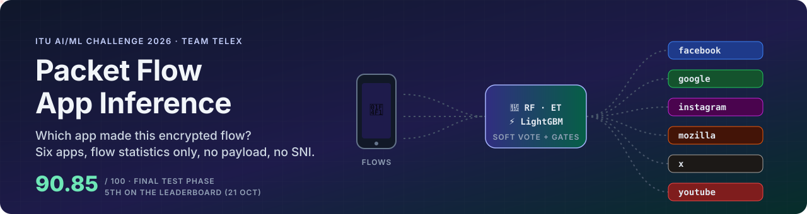
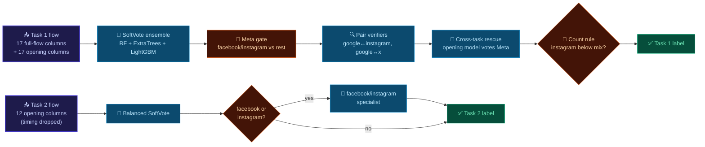
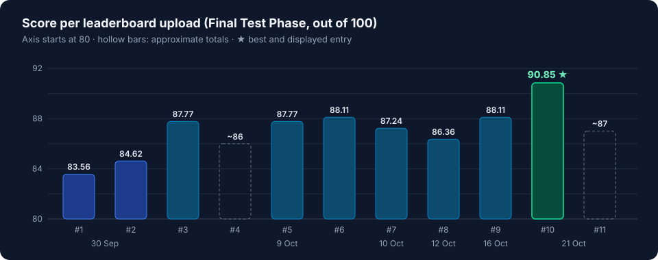
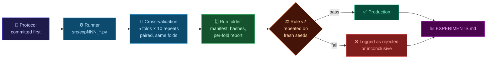
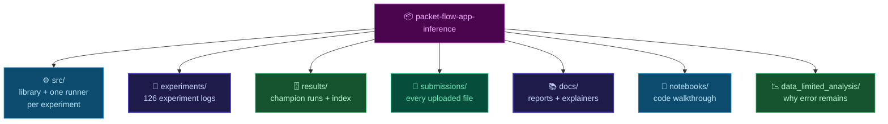

<p align="center">
  
</p>

<p align="center">
  
  
  
  <br/>
  
  
  
  
  
</p>

<p align="center">
  <b>Which app produced this encrypted network flow?</b><br/>
  Our entry (team <b>Telex</b>) to the ITU AI/ML Challenge <i>Application Inference from Packet Flows</i>:<br/>
  label mobile flows as one of six apps from flow statistics alone: no payload, no SNI, no IP addresses.
</p>

<p align="center">
  <a href="#-results">Results</a> ·
  <a href="#-the-challenge">Challenge</a> ·
  <a href="#-how-it-works">How it works</a> ·
  <a href="#-score-journey">Score journey</a> ·
  <a href="#-what-we-learned">What we learned</a> ·
  <a href="#-reproduce">Reproduce</a> ·
  <a href="#-repository-map">Map</a>
</p>

---

<p align="center">
  
  <br/>
  <sub>Official challenge illustration, shown from the organisers' public repository
  <a href="https://github.com/FG-AI4H/application-inference-packet-flows-public">FG-AI4H/application-inference-packet-flows-public</a>.</sub>
</p>

## 🏆 Results

Final Test Phase, 81 hidden test flows, leaderboard read on 21 October 2026.

| | Task 1 · full flow | Task 2 · first 5 packets | **Total** |
|---|---:|---:|---:|
| Macro F1 | 0.912 | 0.905 | |
| Accuracy | 0.90 | 0.89 | |
| Points (50 × macro F1) | 45.60 | 45.25 | **90.85 / 100** |
| Cross-validation macro F1 (production model) | 0.857 | 0.754 | |

> [!NOTE]
> The 90.85 file adds one rule to Task 1: it moves the 3 most instagram-like test flows to instagram so the predicted mix
> matches the training mix. In cross-validation that rule is slightly **worse** (Δ −0.017), so part of the jump from 86.36
> was a bet that paid off on this test set. We say so openly: [how we got 90.85](docs/reports/how-we-got-90-85.md).
> The best score from a model that passed our own adoption rule is **88.11** (experiment 084).

## 🎯 The challenge

Phones generated traffic from six apps; the organisers turned each flow into header-only statistics and removed every direct
identifier. Two tasks, each worth 50 points:

| Task | Input per flow | Columns | Score |
|---|---|---:|---|
| `task1_static` | Statistics of the **whole flow** (sizes, counts, timing) | 17 | 50 × macro F1 |
| `task2_realtime_prefix5` | Statistics of the **first 5 packets** only (real-time setting) | 17 | 50 × macro F1 |

| facebook | google | instagram | mozilla | x | youtube |
|:---:|:---:|:---:|:---:|:---:|:---:|
| 🔵 | 🟢 | 🟣 | 🟠 | ⚫ | 🔴 |

Only **330 labelled flows** (train + validation) were released, with facebook and instagram both rare and similar.
That small, imbalanced dataset shaped every decision below.

## 🧩 How it works

Each test flow takes one of two paths, one per task.



| Stage | What it does | Experiment |
|---|---|---|
| SoftVote | Unweighted mean of random forest, extra trees and LightGBM probabilities | [005](experiments/005_first_submission.md) |
| Opening columns for Task 1 | Task 1 also reads the 17 first-5-packet columns (allowed; disclosed) | [022](experiments/022_t1_plus_prefix.md) |
| Two clerks | A whole-flow expert and an opening expert averaged | [028](experiments/028_two_clerks.md) |
| Meta gate | A facebook/instagram-vs-rest model can pull flows into Meta | [034](experiments/034_meta_gate.md) |
| Pair verifiers | Re-decide instagram and x calls against google | [084](experiments/084_pair_verifiers.md) |
| Bundle + cross-task rescue | Rest-of-flow expert, then an inner Task 2 model rescues missed Meta flows | [089](experiments/089_near_miss_bundle.md), [100](experiments/100_cross_task_meta_rescue.md) |
| Task 2 without timing | Dropping the 5 timing columns: +0.051 macro F1 | [007](experiments/007_drop_timing.md) |
| Task 2 specialist | facebook/instagram calls re-decided by a two-class model | [014](experiments/014_fb_ig_specialist.md) |

## 📈 Score journey



Eleven uploads in three weeks. Every model was adopted on cross-validation evidence first; leaderboard scores were recorded as
information only (81 test flows means one flipped flow can move the total by a point or more). Full history:
[submissions/uploads.csv](submissions/uploads.csv) and [EXPERIMENTS.md](EXPERIMENTS.md#2-leaderboard-history-final-test-phase-81-test-flows).

## 🔬 How every experiment was run

Every one of the 126 experiments followed the same path, from a protocol committed before running to a regenerated index.



**Rule v2**: a variant counts as better only if the paired mean Δ macro F1 is above 0, it wins at least 70% of the non-tied
folds (at least 10 of them), and it passes again on new cross-validation seeds. Rejected and inconclusive results are logged too:
of 126 experiments, 14 were adopted and 52 rejected.

## 💡 What we learned

| | Finding |
|---|---|
| ⏱️ | **Timing hurts the real-time task.** Inter-arrival times in the first 5 packets reflect the network, not the app; dropping them gave Task 2 +0.051 macro F1. |
| 🔗 | **The opening helps the full flow.** Giving Task 1 the first-5-packet columns as well raised CV macro F1 from 0.771 to 0.807. |
| 👥 | **facebook vs instagram is the hard pair.** Both are Meta apps with near-identical traffic; most remaining error lives there, so specialists, gates and verifiers all target it. |
| 📉 | **The error left is data-limited.** With 330 labelled flows (19 instagram), learning curves were still rising; see the [data-limited analysis](data_limited_analysis/REPORT.md). |
| 🎲 | **Small test sets mislead.** 81 test flows: one flow can move the total by about 1 point, so we never tuned toward the leaderboard. |
| ⚖️ | **Simple beats clever on 330 flows.** Per-class probability multipliers overfit (inner folds hold only 1-2 facebook flows); an unweighted soft vote of three tree models held up best. |

More: [FINDINGS.md](FINDINGS.md) (by theme) · [EXPERIMENTS.md](EXPERIMENTS.md) (every experiment) ·
[reports](docs/reports/) · [explainers](docs/explainers/README.md).

## 🛡️ Rules we held ourselves to

| | Rule |
|---|---|
| ✅ | Test labels and the test class counts are never read; models are chosen only by cross-validation on train + validation. |
| ✅ | Task 2 predictions use only the Task 2 files; Task 1 may also read them (allowed by the rules, disclosed). |
| ✅ | No attempt to recover identifiers (SNI, DNS, IP, host names); no outside data or pretrained models in the submission. |
| ✅ | Every run is reproducible: immutable run folders with code and data hashes. |

## 🚀 Reproduce

Requires Python 3.13. The dataset is not copied here: fetch it from the organisers' public repository.

```bash
git clone https://github.com/sidhantbas/packet-flow-app-inference.git
cd packet-flow-app-inference
python3.13 -m venv .venv && .venv/bin/pip install -r requirements.txt

# the released challenge data, pinned to the commit we used
git clone https://github.com/FG-AI4H/application-inference-packet-flows-public data/official
git -C data/official checkout e89586b

# rebuild the 90.85 submission file (predictions match submissions/candidate-127-meta-count-guided/)
.venv/bin/python src/exp127_count_guided_candidate.py
```

Cross-validation for any experiment: `.venv/bin/python src/expNNN_<name>.py`. The shared library is `src/cv.py` (evaluation),
`src/models.py` (every model), `src/runlog.py` (run folders) and `src/make_submission.py`. The
[code walkthrough notebooks](notebooks/code-walkthrough/README.md) explain them cell by cell.

## 🗺️ Repository map



| Path | Contents |
|---|---|
| [`src/`](src/README.md) | `cv.py`, `models.py`, `runlog.py`, `make_submission.py`, and `expNNN_*.py` runners |
| [`experiments/`](experiments/README.md) | One log per experiment: question, protocol, result, decision |
| [`results/`](results/champions.json) | The two production reference runs and `index.jsonl` (summary of all 890 CV runs) |
| [`submissions/`](submissions/README.md) | Each uploaded or candidate file with its model; [`uploads.csv`](submissions/uploads.csv) |
| [`docs/reports/`](docs/reports/) | Write-ups: [how we got 90.85](docs/reports/how-we-got-90-85.md), [leaders vs ours](docs/reports/leaders-vs-ours-dedup.md), [closing the F1 gap](docs/reports/closing-the-f1-gap-2026-10-12.md) |
| [`docs/explainers/`](docs/explainers/README.md) | Plain-language explainers with diagrams |
| [`data_limited_analysis/`](data_limited_analysis/REPORT.md) | Residual-error analysis and decision guide |

## 🙌 Team and credits

- **Sid** ([@sidhantbas](https://github.com/sidhantbas)): experiments, models and this repository.
- **Charles Cai** ([@charles-cai](https://github.com/charles-cai)): registered challenge participant and collaborator.
- Challenge, dataset and evaluation by the organisers of the ITU AI/ML Challenge *Application Inference from Packet Flows*
  ([public repository](https://github.com/FG-AI4H/application-inference-packet-flows-public)). The dataset is theirs and is
  not redistributed here.
