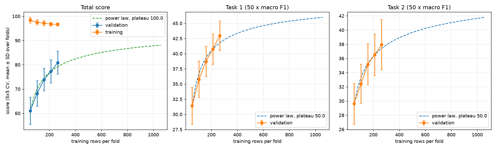
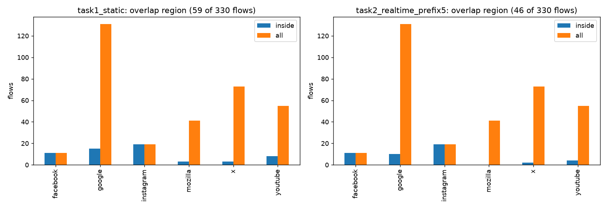
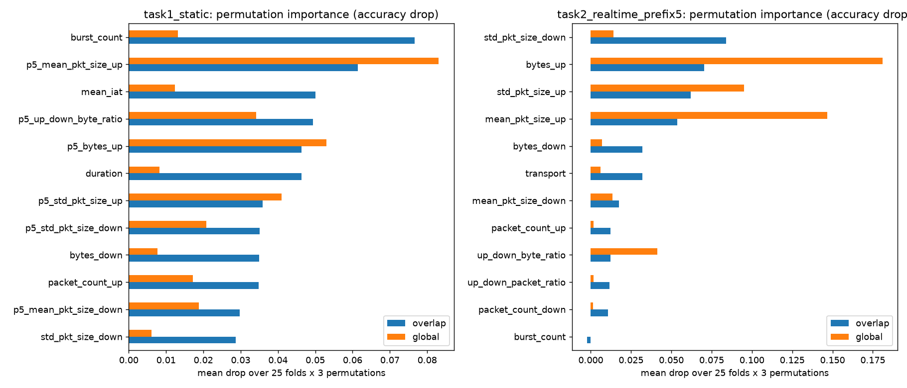
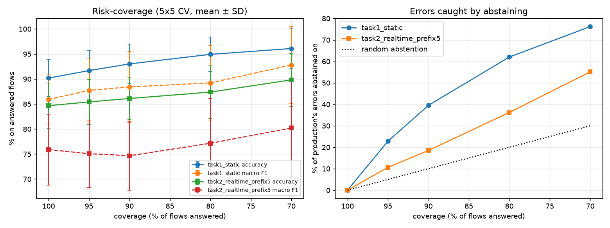
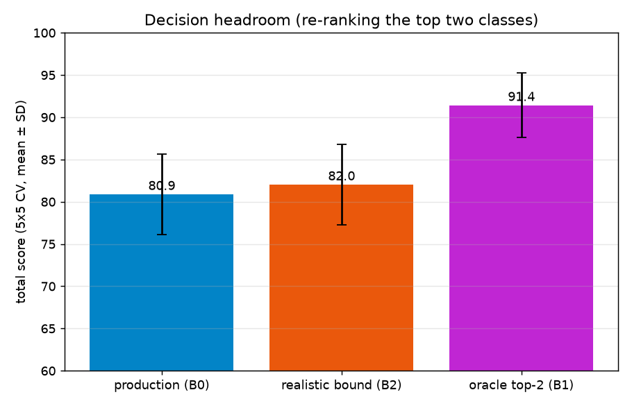

# Data-limited analysis

**Bottom line:** the residual error is **data-limited**. The learning curve is still rising, and every in-data lever fails to beat
production: removing suspect labels, five derivable feature hypotheses, self-training and monotonic constraints. The
confusable cases share their openings and differ only in body behaviour, or are exact duplicates. Closing the gap needs **more
labelled flows from the challenge's own capture setup** and/or **richer per-flow information**, not a new model.

Plain-language companion on the decision side: [decision-making-guide.md](decision-making-guide.md).

Protocol: [PROTOCOL.md](PROTOCOL.md), committed before Phases 1-5 ran. Production code in `src/` was not modified. Scripts, JSON
and CSV outputs are in this folder; figures in [figures/](figures/).

## Setup (applies everywhere)

| Item | Setting |
|---|---|
| Data | 330 labelled flows (train + validation), 6 classes; facebook 11, instagram 19 |
| Metric | Challenge score = 50 × macro F1 (Task 1) + 50 × macro F1 (Task 2), per fold |
| CV | `RepeatedStratifiedKFold(5, 5, random_state=2026)`; model seed = fold index; same splits in both tasks |
| Baseline | Production: Task 1 `models.task1_bundle` (089), Task 2 `models.task2_model` (014) |
| "Beats" | Mean paired Δ (identical folds) > 1 SD of the paired fold differences; otherwise TIE (user decision) |
| Seeds | CV 2026; subsample seeds 0-2 (Phase 1); permutation seeds 0-2 (Phase 4); all in the phase JSON files |
| Deviations | SHAP is not installed (and installing into the production environment is not allowed before the deadline): permutation importance used, as the brief allows. cleanlab not used (user decision): own confident-learning code |

## 0. Baseline reproduction

| Pipeline | Task 1 macro F1 | Task 2 macro F1 | Score, mean ± SD (25 folds) |
|---|---:|---:|---:|
| The 88.11 leaderboard file (Task 1 084 ALL) | 0.844 ± 0.051 | 0.759 ± 0.071 | 80.16 ± 4.86 |
| **Production (baseline here)** | **0.859 ± 0.049** | **0.759 ± 0.071** | **80.90 ± 4.74** |

88.11 cannot be reproduced by CV, and was not expected to be: it is a single leaderboard score on 81 test flows, not a CV
estimate. Most of the difference is Task 2 (0.905 on test vs 0.759 in CV), whose test flows have near-twins in the labelled set
more often than CV held-out flows (experiment 036). CV models also train on 264 flows, the final model on 330, which matters
because the learning curve is still rising (Phase 1). The pipeline itself rebuilds the leaderboard file byte for byte.
Accepted by the user before continuing.

## 1. Learning curve: sample-limited

| Training rows per fold (share) | 52 (20%) | 105 (40%) | 158 (60%) | 211 (80%) | 264 (100%) |
|---|---:|---:|---:|---:|---:|
| Validation score | 61.0 ± 5.6 | 68.2 ± 5.2 | 73.9 ± 4.7 | 77.3 ± 4.8 | **80.9 ± 4.7** |
| Task 1 (50 × F1) | 31.4 | 35.8 | 38.7 | 40.8 | 43.0 |
| Task 2 (50 × F1) | 29.6 | 32.4 | 35.2 | 36.5 | 37.9 |
| Training score | 98.4 | 97.5 | 97.2 | 96.8 | 96.6 |

- **Verdict: sample-limited (still rising).** 80% → 100% adds **+3.6 points** (paired SD 2.6): a clear rise by the agreed
  rule. Task 1 +2.2 (SD 2.0) and Task 2 +1.4 (SD 1.6) both still climb.
- **Train–validation gap of 15.7 points** at full size: the high-variance signature of too few examples.
- **Power law** $S(n) = a - b\,n^{-c}$: the plateau is **not identifiable** from these five points. The fit ran into its bounds
  (100 total, 50 per task), and it slightly underestimates the last point (79.2 vs 80.9). As a rough guide only, it needs about
  **35 more rows per fold for +1 point** and **76 for +2**: about **43 and 95 extra labelled flows** at the 330-flow scale,
  drawn from the same distribution and class mix. A hard cap exists for Task 2: identical openings with different labels limit
  its macro F1 to about 0.93 (46.5 points; experiment 004), so the Task 2 curve must flatten below the fitted 50.

## 2. Label quality: noise costs about nothing

Probabilities: balanced SoftVote, out-of-fold over the 5 × 5 CV, averaged per flow. Suspect lists (features, given and predicted
label, probabilities, suspicion score, confident-learning flag), sorted by suspicion:
[phase2_suspects_task1_static.csv](phase2_suspects_task1_static.csv),
[phase2_suspects_task2_realtime_prefix5.csv](phase2_suspects_task2_realtime_prefix5.csv).

| | Task 1 | Task 2 |
|---|---|---|
| Confident-learning flags | 10 (google 5, youtube 3, instagram 2) | 27 (google 8, instagram 7, facebook 6, youtube 4, x 1, mozilla 1) |
| Confidently wrong (p ≥ 0.6) | 21, mostly google ↔ youtube (8), google → mozilla/x (6) | 38, mostly youtube ↔ google (13), facebook ↔ instagram (8), mozilla → x (5) |

**Sensitivity** (top suspects removed inside each training fold, ranked by an inner CV; held-out flows untouched):

| Removed | Task 1 Δ score | Verdict | Task 2 Δ score | Verdict |
|---|---:|---|---:|---|
| top 1% | −0.88 ± 2.15 | TIE | +0.14 ± 0.49 | TIE |
| top 2% | −1.90 ± 2.75 | TIE | +0.76 ± 2.20 | TIE |
| top 5% | −3.84 ± 2.92 | **WORSE** | −0.86 ± 2.67 | TIE |

**Label-noise estimate: about 0 points**, with an upper bound of about +0.8 (Task 2, top 2%, a tie). Removing suspects never
helps and hurts Task 1 more the more is removed. The suspects are hard **real** examples in overlap zones; the Task 2 flags on
facebook/instagram sit on identical openings, not wrong labels. Consistent with experiment 092 (cleaning with Meta protected,
fresh seed 2036: WORSE in both tasks). Not adopted.

## 3. Overlap region and acquisition spec

Region = flows with out-of-fold margin (top-1 − top-2 probability) below 0.25, plus all facebook and instagram flows.
Lists: [phase3_region_task1_static.csv](phase3_region_task1_static.csv), [phase3_region_task2_realtime_prefix5.csv](phase3_region_task2_realtime_prefix5.csv).

| | Task 1 | Task 2 |
|---|---|---|
| Flows in region | 59 of 330 (36 by low margin) | 46 of 330 (20 by low margin) |
| Low-margin pairs | google/youtube 15, google/mozilla 6, google/x 5 | google/youtube 12, facebook/instagram 4 |
| Classes | facebook and instagram 100%; youtube 15%, google 12%, mozilla 7%, x 4% | facebook and instagram 100%; google 8%, youtube 7% |
| QUIC share | 63% inside vs 50% outside | 70% inside vs 49% outside |
| Distinctive features | **long, bursty flows**: median 5 bursts vs 2, 116 s vs 9 s, 28 vs 14 down packets | **UDP 2/3 openings** (19), UDP 1/4 (7, Meta only); fewer up packets, much larger down-size spread (487 vs 4) |

**Unlabelled data:** only the 81 test flows. Their labels can never be obtained (challenge rule 1), so no labelling list is
exported. **Acquisition spec** (what new labelled flows would be worth most, in order):

1. **facebook flows of all five traffic styles** (TCP keep-alive, short TCP, short QUIC fetch, QUIC burst, slow trickle;
   experiment 041), at least 4-6 per style; and **instagram flows with the shared Meta openings** (UDP 1/4 and UDP 2/3 with a
   1365/1367-B first packet).
2. **google and youtube QUIC flows with UDP 2/3 or 3/2 openings and long bodies** (≥ 5 bursts, > 100 s), the low-margin
   google/youtube zone.
3. **google flows with TCP 3/2 openings** next to mozilla and x (first message 583 B is shared by x, youtube, google, mozilla).

**Hard requirement:** the flows must come from the challenge's own capture setup. Three independent 2026 references (our
iPhone, our Android, a public Android dataset) all lack its opening signature: Meta QUIC first packet 1365/1367 B, TCP first
packet 145-175 B (experiments 059, 091). Flows without it hurt in training (056-063).

## 4. Feature gaps

**Confusable pairs** (mutual nearest neighbours with different labels):

| | Task 1 | Task 2 |
|---|---|---|
| Pairs | 11 (google/youtube 8, mozilla/x, facebook/instagram, facebook/x 1 each) | 8 (google/youtube 3, facebook/instagram 3, instagram/youtube, google/mozilla) |
| Exact duplicates | 0 | **4** |
| Same transport | 100% | 100% |
| Most similar columns | the opening: transport, opening burst count, opening packet counts and ratios | transport, packet counts, burst count |
| Most different columns | the **body**: burst count, gap spread and maximum, byte ratio, down size, mean gap | up-size spread, byte ratio, sizes |

**Permutation importance** (accuracy drop; full table in `phase4a_pairs_importance.json`):

- **Task 1, overlap region:** `burst_count`, `p5_mean_pkt_size_up`, `mean_iat`, `p5_up_down_byte_ratio`, `p5_bytes_up`, `duration`.
- **Task 1, all flows:** opening sizes dominate (`p5_mean_pkt_size_up`, `p5_bytes_up`, `p5_std_pkt_size_up`, …, `transport`).
- **Task 2:** the same size columns in both views, with `std_pkt_size_down` first in the overlap region.

Reading: globally the opening identifies the app. In the hard cases the openings are the same, and the model falls back on
**body behaviour over time**, which the summary card describes only with a few totals and averages.

**Hypotheses for the missing information:**

| # | Hypothesis | Source | Test |
|---|---|---|---|
| H1 | Decoded opening stamps (first packet, first message, server reply sizes) | derivable | below |
| H2 | Tempo change between the opening and the rest of the flow | derivable | below |
| H3 | Burst intensity (packets and bytes per burst) | derivable | below |
| H4 | Size asymmetry and spread per direction | derivable | below |
| H5 | Share of bytes and time in the opening | derivable | below |
| H6 | Packet-by-packet sequence of the body (sizes, directions, gaps), e.g. burst-level histograms | **requires new data** (packet-level traces) | — |
| H7 | Per-burst statistics (sizes and duration of each burst, not just their number) | **requires new data** | — |
| H8 | More labelled flows of the overlap styles (section 3) | **requires new data** | — |
| H9 | Connection context: other flows of the same session | requires the capture-time and order columns, which our rules treat as off-limits (experiment 039) | not tested |

**Tests** (extra columns on top of production; paired, 5 × 5 CV):

| Hypothesis | Task | Δ score | Wins / losses | Verdict |
|---|---|---:|---|---|
| H1 stamps | 1 | −0.79 ± 2.05 | 7 / 13 | TIE |
| H1 stamps | 2 | +0.03 ± 1.25 | 9 / 7 | TIE |
| H2 tempo change | 1 | −0.75 ± 1.46 | 1 / 10 | TIE |
| H3 burst intensity | 1 | −0.12 ± 1.13 | 6 / 5 | TIE |
| H3 burst intensity | 2 | −0.31 ± 1.15 | 3 / 6 | TIE |
| H4 asymmetry, spread | 1 | −0.76 ± 1.23 | 3 / 13 | TIE |
| H4 asymmetry, spread | 2 | +0.10 ± 0.62 | 6 / 6 | TIE |
| H5 opening share | 1 | −0.53 ± 1.38 | 5 / 10 | TIE |

**None beats the baseline by more than one SD**, and Task 1 leans negative: every derivable re-expression of the card is already
available to the trees, and extra columns add noise on 264 rows. Consistent with experiments 008-011, 020, 030 and 090.

## 5. Semi-supervised learning and constraints

| Method | Task | Δ score | Wins / losses | Verdict |
|---|---|---:|---|---|
| Self-training (pool = held-out fold + 81 test rows, features only; pseudo-labels at p ≥ 0.9; 65 rows added on average) | 1 | −0.16 ± 1.07 | 5 / 11 | TIE |
| Same (102 rows added on average) | 2 | +0.02 ± 0.68 | 5 / 5 | TIE |
| Monotonic constraints in the two Task 1 pairwise verifiers' LightGBM member | 1 | −0.03 ± 0.39 | 3 / 3 | TIE |

- Self-training adds only flows the model already gets right (confident), so it adds no information (as experiment 025).
- **Constraints assumed, please verify:**
  - google-vs-x verifier: P(x) **decreasing** in `transport` (UDP = 1) and in `p5_mean_pkt_size_up`. x is TCP-only in the labelled data, with tiny openings (032).
  - google-vs-instagram verifier: P(instagram) **increasing** in `burst_count` and `bytes_down` (instagram bursts and media downloads, 032 and 041).
  
  They keep the score (tie), so they are safe but add nothing. The multi-class members and the Task 2 pair stage stay
  unconstrained: app identity has no class-independent monotone direction in any column.
- **External options (nothing downloaded here):**

| Resource | Status |
|---|---|
| Social Media Application Traffic Dataset (Mendeley `6v3zcxysh7`, Aug 2026, CC BY 4.0) | Already checked (experiment 091): 0% of its Meta QUIC first packets match the challenge signature; not usable |
| MIRAGE-2019 (Zenodo, CC BY-NC-ND 4.0), MIRAGE-APP×ACT-2024, UTMobileNet2021 | Older app versions than the 2026 reference that already fails; NoDerivs licence on MIRAGE-2019 |
| CIC AndMal 2017/2020 | Malware traffic, wrong apps |
| TabPFN (local, pretrained tabular model) | Tried as an extra expert (024, 078): +0.003, below the bar; excluded by the team's no-pretrained-model rule |
| Packet- or payload-level pretrained traffic models | Need raw packets or payload bytes; not applicable to summary features, and payload use conflicts with challenge rule 3 |

## 6. Reject option: risk–coverage (addendum)

The challenge needs a label for every flow, so abstention cannot be used in a submission. This section shows what a
**human-review deployment** would gain. Labels come from production; confidence is the margin (top-1 − top-2 probability) of a
balanced SoftVote trained on the same fold. The least confident share of each held-out fold is abstained on (5 × 5 CV,
mean ± SD over folds). Script `risk_coverage.py`, output `risk_coverage.json`.

| Abstain on | Task 1 accuracy | Task 1 macro F1 | Task 1 errors caught | Task 2 accuracy | Task 2 macro F1 | Task 2 errors caught |
|---|---:|---:|---:|---:|---:|---:|
| 0% | 0.902 ± 0.037 | 0.859 ± 0.049 | — | 0.847 ± 0.045 | 0.759 ± 0.071 | — |
| 5% | 0.917 ± 0.041 | 0.877 ± 0.063 | 23% | 0.854 ± 0.045 | 0.751 ± 0.067 | 11% |
| 10% | 0.930 ± 0.040 | 0.884 ± 0.071 | 40% | 0.861 ± 0.042 | 0.747 ± 0.069 | 19% |
| 20% | 0.949 ± 0.035 | 0.892 ± 0.075 | 62% | 0.874 ± 0.052 | 0.772 ± 0.090 | 36% |
| 30% | 0.961 ± 0.039 | 0.928 ± 0.077 | 76% | 0.898 ± 0.053 | 0.802 ± 0.098 | 55% |

Random abstention would catch errors only in proportion to the share abstained (5%, 10%, …).

- **Task 1: the model knows where it is unsure.** Abstaining on 10% of flows catches **40%** of its errors (4× random); at 30%
  it catches 76% and answered-flow accuracy reaches 0.96. The abstained flows are mostly google and youtube (the overlap zone)
  and a large share of the facebook flows: about a third of facebook appearances already at 5%.
- **Task 2: much weaker.** 10% abstention catches only 19% of errors (2× random), and macro F1 even dips at 5-10%, because
  correct minority-class answers (instagram) are among the low-margin flows. Most Task 2 errors are **confident**: they sit on
  exact-duplicate openings, where the model has memorised the majority label and cannot know it is wrong. That is the Bayes-error
  signature from Phase 4. Abstention cannot find errors that look certain.
- **For the report:** a review queue of the least confident ~10-20% would be worthwhile for full-flow classification (Task 1),
  and of limited use for 5-packet real-time classification (Task 2), where the residual error is irreducible from the features.

## 7. Decision headroom (addendum 2)

How much could **any** decision rule add on top of production's labels, given the probabilities? Per fold: production labels and
a balanced SoftVote probability ranking (5 × 5 CV). Script `decision_headroom.py`, output `decision_headroom.json`.

| | Task 1 macro F1 | Task 2 macro F1 | Total score |
|---|---:|---:|---:|
| B0 production | 0.859 ± 0.049 | 0.759 ± 0.071 | 80.90 ± 4.74 |
| B2 realistic: perfect flips of close calls (margin < 0.25, true label in top 2) | 0.873 ± 0.052 | 0.768 ± 0.069 | **82.04 ± 4.77 (+1.14)** |
| B1 oracle: perfect flips of every error whose true label is in the top 2 | 0.916 ± 0.044 | 0.913 ± 0.051 | 91.43 ± 3.80 (+10.5) |

| Production errors (25 folds) | Task 1 | Task 2 |
|---|---:|---:|
| Total | 162 | 253 |
| True label is the second choice (reachable by re-ranking) | 77 | 158 |
| … and the call is close (margin < 0.25) | **19** | **16** |
| True label ranks third or lower (unreachable) | 85 | 95 |

- **Most second-choice errors are confident.** 77 of 162 Task 1 errors and 158 of 253 Task 2 errors have the true app as the
  model's second choice, but only 19 and 16 of them are close calls. The rest have a clear margin for the wrong class: a decision
  rule cannot tell them apart from correct confident answers. Reaching B1 would need information, not decisions.
- **The realistic headroom (+1.14 points) is an oracle bound on close calls**, and it is mostly google ↔ youtube (Task 1: 10 of 19;
  Task 2: 11 of 16), where the close calls go both ways. A real rule cannot know the direction of each flip; the best it can do is
  favour the class that macro F1 values more (the F/2 threshold rule). Experiment 062 did exactly that among non-Meta classes and
  gained about +0.003 macro F1 (+0.15 points), positive on 5 of 5 seeds but BETTER on only 3. That is about 13% of the realistic
  bound, which is the typical share a rule without the true labels can recover.
- **By the reading fixed in advance** (B2 − B0 ≥ 1 point), a decision rule aimed at the close calls may be proposed under its own
  protocol. On the evidence of 062, its expected gain is about +0.1 to +0.3 points.

## Ranked next three actions

| Rank | Action | Why | Expected impact |
|---|---|---|---|
| 1 | **Obtain more labelled flows from the challenge's own capture setup**, prioritised by the acquisition spec (facebook styles first, then the google/youtube long-QUIC zone) | The learning curve is still rising (+3.6 points from 80% to 100%); noise, features, self-training and constraints all tie | Roughly +1 point per ~43 extra flows and +2 per ~95 (rough power-law guide); largest per flow for facebook, where 2 → 6 rows raised facebook F1 0.04 → 0.37 (Charles, afe-002) |
| 2 | **Obtain richer per-flow information** (H6, H7): packet-level body sequences or per-burst statistics | The hard cases share openings and differ only in body behaviour, which the summary columns compress; Task 2 has exact duplicates no model can split | Unknown size; the only route that lowers the irreducible part (Task 2 cap about 0.93 macro F1) |
| 3 | **Identify the capture-setup difference** (client first packets 70-100 B larger than in all 2026 references) | Matching it would make our own captures valid training data, the cheapest way to deliver action 1 | Enabler: no gain by itself; unlocks action 1 at scale if solved |

Not recommended: further in-data modelling. Every lever tested here and in experiments 052-092 ties or loses against production.
