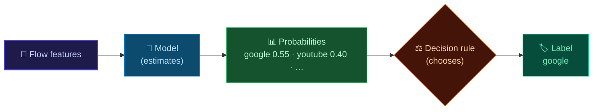
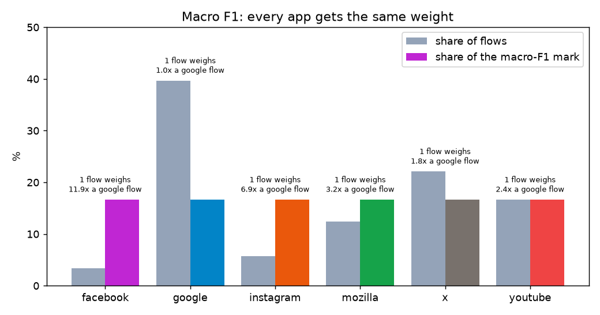
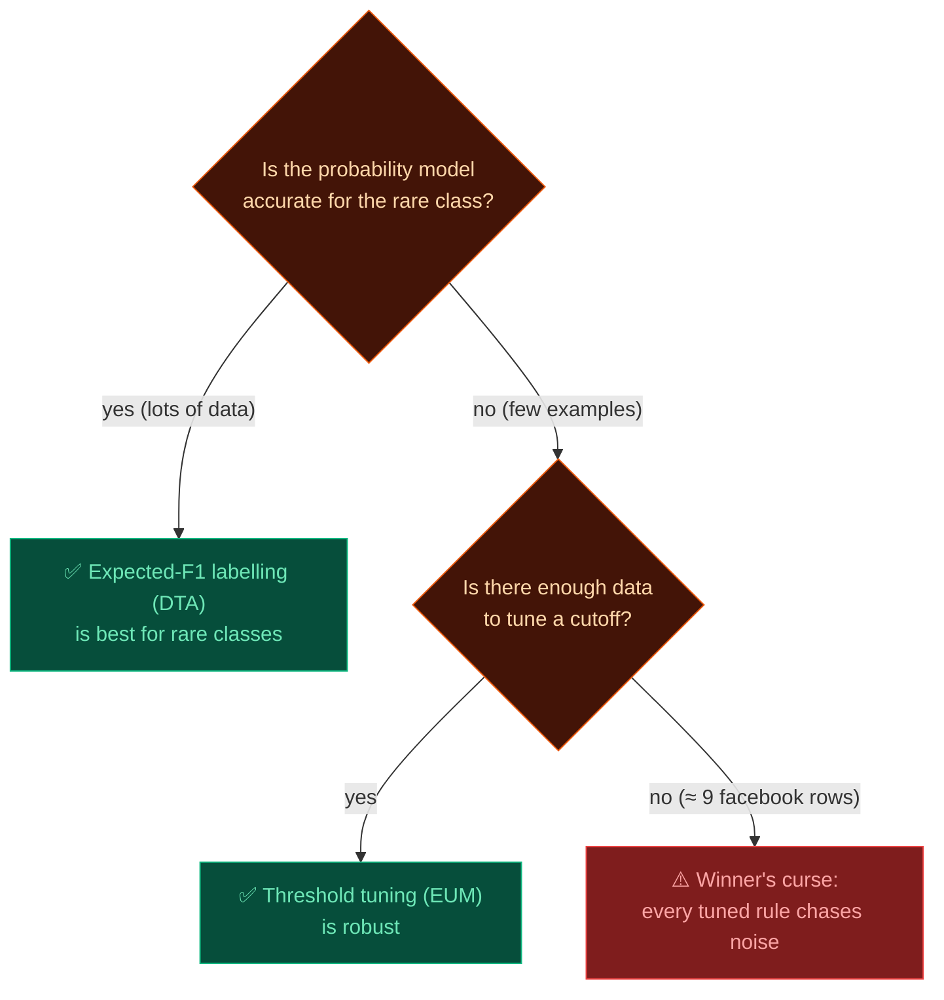
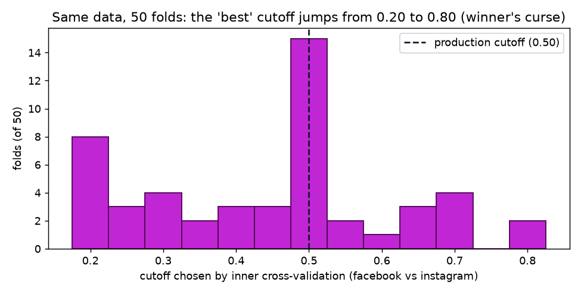
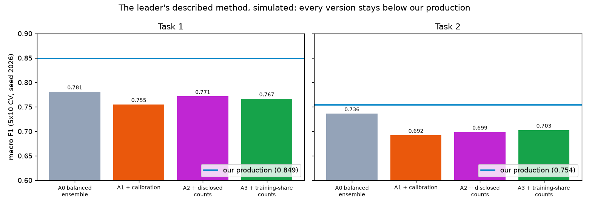
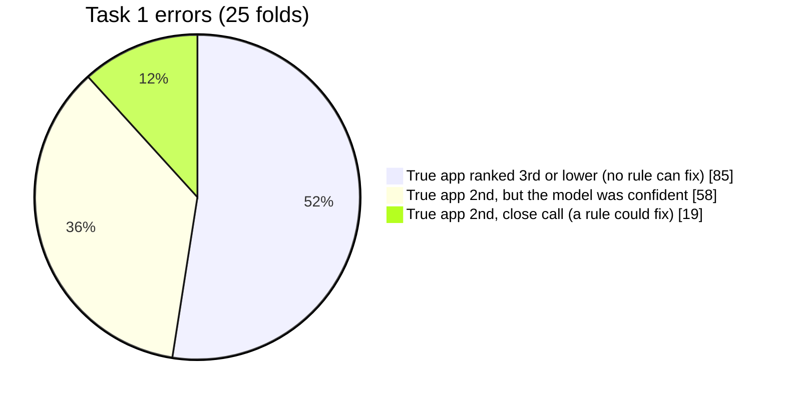
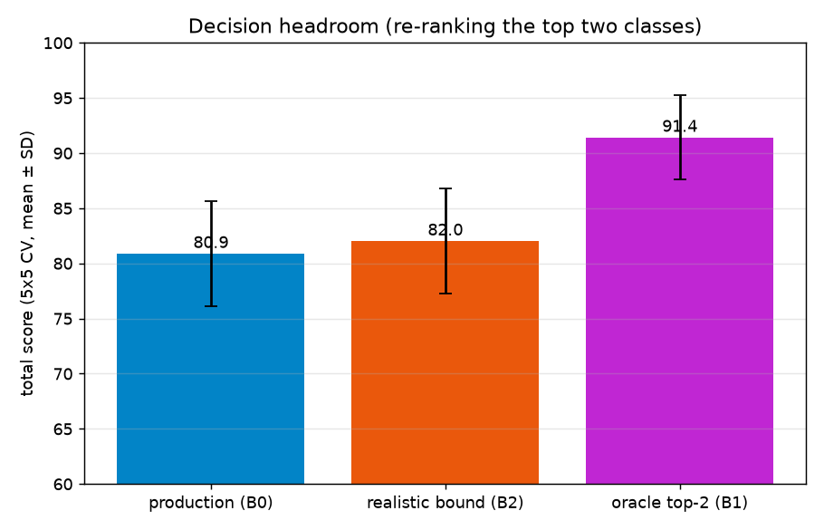
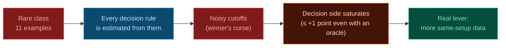

# Decision-making for rare classes: a simple guide

A model does two jobs. It **estimates** how likely each answer is, then it **decides** which answer to give. This guide is about
the second job: what the options are, what the research says about them, and what happened when we tried each one on our data.

## 1. Two jobs inside every classifier

The model's probabilities go into a decision rule, and only the decision rule produces the label.

The default rule is "**pick the most likely class**" (argmax). It is the best rule for plain accuracy. For our metric it is not
automatically the best, which is why the decision side deserves its own attention.

## 2. Why our metric makes decisions matter

Our score uses **macro F1**: the F1 of each app, averaged with equal weight. Facebook has 11 flows and google 131, yet both count
for one sixth of the mark.

So one facebook flow weighs about **12 times** one google flow. A decision rule that says "facebook" a little more often can
pay off, but only if it picks the *right* extra flows.

## 3. The decision toolbox

The literature and practice offer five tools. In plain words:

| Tool | Plain idea | Research name | Paper |
|---|---|---|---|
| 🎚️ **Threshold tuning** | Say "facebook" already at 30% confidence instead of waiting for it to win | Empirical utility maximisation (EUM), threshold-moving | Lipton et al. 2014; Collell et al. 2016 |
| ⚖️ **Class weights** | Tell the model during training that rare apps matter more | Cost-sensitive learning, logit adjustment | Menon et al. 2021 |
| 🧮 **Class-weighted argmax** | Multiply each app's probability by a weight before picking | Plug-in Bayes-optimal rule | Narasimhan et al. 2015; Wang et al. 2019 |
| 🎯 **Expected-F1 labelling** | Look at the whole batch and choose the labels with the best *expected* score | Decision-theoretic approach (DTA) | Ye et al. 2012 |
| 🔢 **Count matching** | If you know how many flows of each app are in the batch, hand out exactly that many labels | Quota or prior matching | (the leader's "disclosed-count analysis") |
| ✋ **Reject option** | Say "not sure" on close calls and send them to a human | Selective classification | — |

## 4. What the research says about our situation

Four findings sum it up:

1. **Ye et al. 2012:** expected-F1 labelling wins on rare classes, *if* the probabilities are accurate. Threshold tuning is
   sturdier when they are not, but rare classes need more data before it can be trusted.
2. **Lipton et al. 2014:** for calibrated probabilities, the best F1 cutoff is about **half the best F1**. Picking a cutoff from
   data suffers a **winner's curse**: a bad cutoff can win by luck, so real performance comes out lower than it looked.
3. **Narasimhan et al. 2015, Wang et al. 2019:** the theoretically best rule for macro F1 is a **class-weighted argmax**. The proof
   holds **as the data grows**.
4. **Menon et al. 2021:** adjusting by the class frequency (logit adjustment) is a sound, parameter-free rule for balanced
   error. Training with balanced class weights does the same job.

**Our position:** the bottom-right box. All the good rules exist, but each one has to be **estimated from the rare class**, and we
have about 9 facebook rows per training fold.

## 5. The winner's curse, seen in our own data

In experiment 067 we let inner cross-validation pick the facebook-vs-instagram cutoff in each of 50 folds. Same data, same
method:

The chosen cutoff scatters from **0.20 to 0.80**. A rule that changes this much between folds is following noise, not facebook.

## 6. What we tried, and what happened

| Tool | Experiments | Result |
|---|---|---|
| 🎚️ Threshold tuning | 061, 062, 067 | 061 and 067 no gain; 062 positive on all five seeds (+0.003) but passed the referee on only 3 |
| ⚖️ Class weights | 012 (in production) | ✅ **Needed**: facebook −0.09 without them; the Task 2 sibling stage works best unweighted (014) |
| 🧮 Class-weighted argmax | 004 | ❌ Hurt in all four settings; weights fitted on 1-2 facebook rows |
| 🎯 Expected-F1 labelling | 088 | ❌ Coin flips (23 folds won, 23 lost) |
| 🔢 Count matching, facebook only | 043 | ❌ Task 1 inconclusive, Task 2 worse |
| 🔢 Count matching, leader style | 095 | ❌ Below production in every version (next section) |
| 🏗️ Hierarchical decision ("is it Meta?") | 034 (in production) | ✅ facebook F1 0.59 → 0.67 |
| ✋ Reject option | risk–coverage, report section 6 | Not allowed in the challenge; useful in deployment for Task 1 |

The two tools that worked, class weights and the hierarchical gate, share one feature: **they don't fit a cutoff on the rare
class.** They borrow strength from more data (all Meta flows, or the whole training set).

## 7. The leader's method, simulated

The leader described their method as a "class-balanced ensemble with probability calibration and disclosed-count analysis". We
rebuilt it in cross-validation. Each held-out fold's own true counts played the "disclosed counts"; the test counts were never
read.

- **Calibration hurt the rare class** (facebook F1 −0.14 in Task 1, −0.34 in Task 2): it is fitted on about 6 facebook rows.
- **Count matching repaired facebook** but took flows from the other apps.
- **The disclosed counts were worth almost nothing** compared with counts estimated from the training shares (+0.005 / −0.004).
  The splits are stratified, so every batch already holds roughly the training share of each app.

## 8. How much could perfect decisions ever add?

We asked the most generous question: if a rule knew exactly when to swap the model's first and second choice, how much would the
score rise? (Report section 7.)

- A perfect swap on **close calls** adds at most **+1.1 points**. A real rule can't know which way each swap should go; our best
  one (062) recovered about 13% of that.
- The big **+10.5 points** needs swapping *confident* mistakes, which no decision rule can spot. Only new information can.

## 9. The takeaway

- **The decision side matters most when the rare class has enough examples to estimate it.** With hundreds of facebook flows,
  threshold tuning and expected-F1 labelling would likely pay off. With 11, they chase noise.
- **Rules that borrow strength win:** class weights and the "is it Meta?" gate.
- **Our decision layer is already where the evidence puts it.** What would move it further is the same thing that would improve the
  model: more labelled flows from the same capture setup.

## Glossary

| Term | Meaning |
|---|---|
| **Argmax** | Pick the class with the highest probability |
| **Macro F1** | F1 per class, averaged with equal weight; rare classes count as much as common ones |
| **Threshold / cutoff** | The confidence level at which a class is chosen |
| **Calibration** | Adjusting probabilities so that "70% sure" is right about 70% of the time |
| **EUM** | Empirical utility maximisation: tune the rule to score best on held-out data |
| **DTA** | Decision-theoretic approach: choose labels that maximise the *expected* score from the probabilities |
| **Plug-in rule** | Train a probability model first, then apply a decision rule on top |
| **Bayes-optimal** | The best possible rule if the true probabilities were known |
| **Winner's curse** | Picking the best-looking option from noisy estimates; it looks better than it really is |
| **Stratified split** | A split that keeps each class's share the same in every part |

## Sources

- [Ye et al. 2012, Optimizing F-measure: A Tale of Two Approaches](https://arxiv.org/abs/1206.4625)
- [Lipton et al. 2014, Thresholding Classifiers to Maximize F1 Score](https://arxiv.org/pdf/1402.1892)
- [Narasimhan et al. 2015, Consistent Multiclass Algorithms for Complex Performance Measures](https://proceedings.mlr.press/v37/narasimhanb15.html)
- [Narasimhan et al. 2024, Consistent Multiclass Algorithms for Complex Metrics and Constraints](https://www.jmlr.org/beta/papers/v25/22-1137.html)
- [Wang et al. 2019, weighted classifiers for non-decomposable metrics](https://arxiv.org/pdf/1908.09057v1.pdf)
- [Dembczyński et al., On the Bayes-optimality of F-measure Maximizers](https://ar5iv.arxiv.org/html/1310.4849)
- [Menon et al. 2021, Long-tail learning via logit adjustment](https://arxiv.org/abs/2007.07314v2)
- [Collell et al. 2016, Reviving Threshold-Moving](https://arxiv.org/abs/1606.08698)
- [Hernández-Orallo et al., Threshold Choice Methods: the Missing Link](https://arxiv.org/pdf/1112.2640)
- [Confidence intervals for micro- and macro-averaged F1](https://www.ncbi.nlm.nih.gov/pmc/articles/PMC8936911/)
- [Opitz & Burst, Macro F1 and Macro F1](https://arxiv.org/pdf/1911.03347)

Our evidence: experiments 004, 012, 014, 034, 043, 061, 062, 067, 088, 095 and the [data-limited report](REPORT.md) (sections 6-7).
Figures are drawn from logged results by [`make_guide_figures.py`](make_guide_figures.py); no new model runs.
