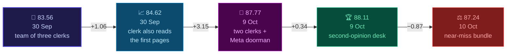
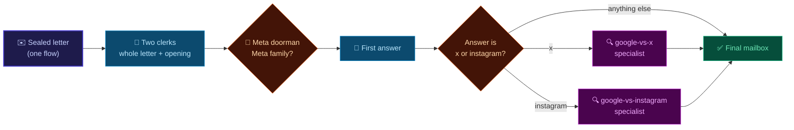
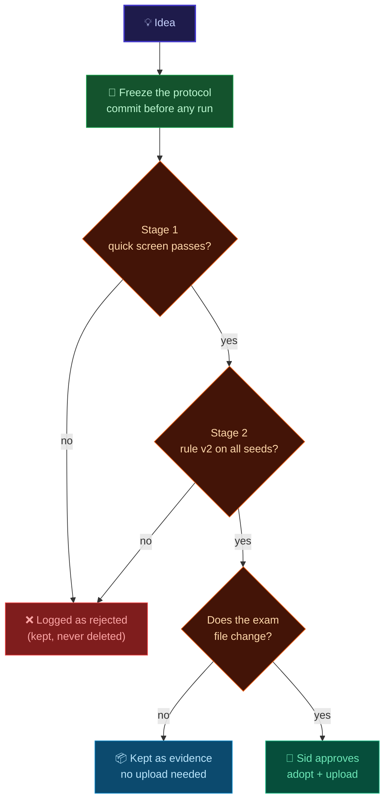
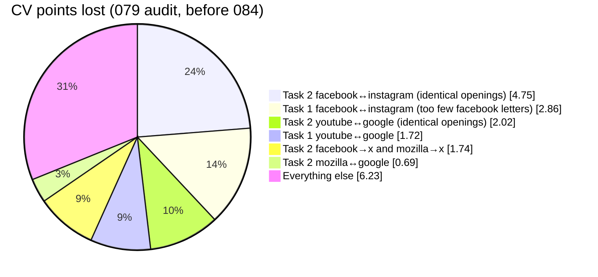

# How we climbed the score, explained with an analogy

This guide explains, in plain words, **how our score went from 83.56 to 88.11**, why each step worked, and why the last upload scored 87.24. It uses one picture all
the way through: a post office that sorts sealed letters.

## 1. The analogy: a post office for sealed letters

Imagine a post office that receives **sealed, unlabelled letters** and must put each one in the right one of **six mailboxes**:
facebook, google, instagram, mozilla, x and youtube.

The clerks may **not open the letters** (the traffic is encrypted, and the rules forbid reading names, addresses or contents). They
can only look at the outside: how heavy the letter is, how many pages it seems to have, how fast the pages arrived, and whether it
came by one courier (TCP) or another (QUIC/UDP).

| In the post office | In our project |
|---|---|
| A sealed letter | One network flow (a conversation between the phone and a server) |
| The six mailboxes | The six apps |
| Looking at the envelope only | Using flow statistics only (sizes, counts, timing), never identifiers |
| The whole letter, all pages | **Task 1**: statistics of the full flow |
| Only the first five pages | **Task 2**: statistics of the first 5 packets |
| The training pile with known senders | 330 labelled flows (train + validation) |
| The exam pile | 81 test flows, scored by the organisers |
| A clerk | A machine-learning model |

### How the exam is marked

The examiner gives a mark to **each mailbox separately** and then takes the average (this is "macro F1"). The facebook mailbox
only gets **2 letters** in the exam, the google mailbox about 30, but both mailboxes count the same. So **one facebook letter is
worth far more than one google letter**. This one fact explains many of our choices.

$$
\text{score} = 50 \times \text{macro F1}_{\text{Task 1}} + 50 \times \text{macro F1}_{\text{Task 2}}
$$

## 2. The climb at a glance

Each box is one exam result, and the arrows show what we changed in between.

| Exam | Date | What changed (Task 1) | Task 1 | Task 2 | Total |
|---|---|---|---:|---:|---:|
| 1 | 30 Sep | Team of three clerks (004) | 0.766 | 0.905 | 83.56 |
| 2 | 30 Sep | Clerk also reads the first pages (022) | 0.787 | 0.905 | 84.62 |
| 3 | 9 Oct | Two clerks + Meta doorman (028, 034) | 0.850 | 0.905 | 87.77 |
| 6 | 9 Oct | Second-opinion desk (083 + 084) | ≈ 0.857 | 0.905 | **88.11** |
| 7 | 10 Oct | Near-miss bundle (089) | 0.840 | 0.905 | 87.24 |

Exams 4 (about 86) and 5 (87.77 again) were files that we did not adopt; see section 5. Exam 7 is the bundle (step 7): adopted on
the referee's evidence before the score, it changed two answers and scored 0.87 lower. 💡 **Every point of the climb came from
Task 1.** The Task 2 file has been the same since the first exam. Task 1 ≈ 0.857 is worked out from the total, because Task 2 did
not change.

## 3. The steps, one by one

### Step 0: one clerk becomes a team of three (experiment 004)

One clerk (a Random Forest) has habits and blind spots. We hired **three different clerks** (Random Forest, Extra Trees, LightGBM).
Each gives a confidence for every mailbox, and we average them. Their mistakes partly cancel out.

- Cross-validation: 0.733 → 0.771 (Task 1).
- The facebook mailbox also improved (0.49 → 0.58).

### Step 1 (Task 2): ignore the travel time on the first pages (experiment 007)

On the first five pages, the **time between pages** says more about traffic on the road (network delay) than about who sent the
letter. When the Task 2 clerks stopped looking at it, they got better: +0.051.

### Step 2 (Task 2): a family expert for Facebook and Instagram (experiment 014)

Facebook and Instagram are **siblings from the same family (Meta)**. Their first pages often look identical. A general clerk mixes
them up, so when the team says "facebook" or "instagram", a **family expert** trained only on those two makes the final call:
+0.018. This is the Task 2 file we still use.

### Step 3 (Task 1): read the first pages as well as the whole letter (experiment 022, exam 2)

For Task 1 the rules let us use the Task 2 file too. So the Task 1 clerk now looks at **the whole letter and its first five pages**.
The first pages carry a fingerprint (which courier, the size of the opening pages) that the totals hide. CV +0.021 to +0.039, exam
0.766 → 0.787.

### Step 4 (Task 1): two clerks with different views (experiment 028)

Instead of one clerk who reads everything, we use **two clerks**: one who studies the whole letter and one who studies **only the
opening**. We average their opinions. When either says "Meta family", the whole-letter clerk decides, because the opening alone
cannot tell the siblings apart. CV 0.807 → 0.817 (google, mozilla and youtube improved).

### Step 5 (Task 1): a doorman for the Meta family (experiment 034, exam 3)

Facebook letters are rare and precious (section 1). We added a **doorman** who asks one question: "Does this letter come from the
Meta family at all?" If he is confident it does, the letter goes to the Meta side, and the whole-letter clerk chooses facebook or
instagram. This rescued facebook letters that had been hiding in the google pile. Facebook F1 in CV 0.59 → 0.67; exam Task 1
0.787 → 0.850, our biggest single jump (+3.15 in total).

### Step 6 (Task 1): the second-opinion desk (experiments 083 and 084, exam 6)

This is today's step. Some pairs of mailboxes are **easy to tell apart when you only compare those two** (google vs x, google vs
instagram; a two-mailbox clerk separates them with AUC ≈ 0.99), but the six-mailbox team still mixes them up sometimes.

So we opened a **second-opinion desk**. It works like a doctor who sends a patient to a specialist for one narrow test:

- When the team says **"x"**, a specialist who only knows **google vs x** checks the letter again.
- When the team says **"instagram"**, a specialist who only knows **google vs instagram** checks it again.
- Every other answer is left alone.

Evidence: better on **all five** independent rounds of cross-validation (+0.003 to +0.007, 138 rounds won and 26 lost; the
facebook mailbox untouched). On the 81 exam letters it changed **one answer**, and the total went from 87.77 to 88.11.

**Why a narrow specialist beats the big team on its own question:** the six-mailbox team has to spread its attention over six
choices and 330 letters. The specialist sees only the letters of two mailboxes and learns exactly the border between them. It is
only asked the question it is best at.

**Why not a specialist for every pair?** We tried all nine other well-separated pairs (experiment 085). Where the team is already
mostly right, a specialist breaks more answers than it fixes. Only the two desks above earn their place.

### Step 7 (Task 1): the near-miss bundle (experiment 089, exam 7)

Several helpers had each been "nearly good enough": the **rest-of-letter clerk** (pages 6 onwards), a **doorman who may only rescue
letters into facebook** (so he stops stealing instagram letters), and an **exact-opening rule** (a non-Meta letter whose opening
exactly matches known letters of one non-Meta mailbox gets that mailbox). Each alone was below the referee's detection limit, but
they fix different mailboxes, so we hired them together and asked a **brand-new referee**: five shuffles (seeds 2031-2035) that no
earlier experiment had ever used. The team was better on all five (+0.012 to +0.016; every mailbox except facebook improved, and
facebook held steady).

On the 81 exam letters it changed **two answers**, and the total went from 88.11 to **87.24**. That is the other face of exam
noise: the referee judges on 330 letters, the exam on 81, and two letters can swing either way. We decided before the score that
the referee's verdict stands, so the bundle remains our production model and ranked entry, and we do not use the score to guess
which answers were right.

## 4. The referee: how we decide a step is real

A cook should not change the recipe because of one customer's review. We judge every change by **many blind tastings**.

- **Cross-validation:** we split the 330 known letters into 5 parts, train on 4, test on 1, and repeat this 10 times (50
  tastings). Old and new clerks are tested on exactly the same tastings.
- **Rule v2:** a change counts as better only if it wins at least 70% of the tastings where the two differ, and does it again on
  fresh shuffles (two more for planned ideas, all five for ideas found after looking at results).
- **Frozen protocol:** before running anything, we write down and commit exactly what we will test and what counts as a pass.
  We cannot move the goalposts afterwards.
- **The exam score is never the referee.** 81 letters is a small, noisy sample (one facebook letter moves Task 1 by 2-4 points),
  and choosing by the exam would be using the exam's answers (challenge rule 1).

## 5. Things that did not lift the score (and the lesson in each)

| What we tried | Analogy | What happened | Lesson |
|---|---|---|---|
| Our own phone captures in training (056-063) | Practice letters from **another post office** with different stamps | Facebook F1 fell by up to 0.38 | Letters must come from the same post office; our app versions and capture point differ |
| Rest-of-letter clerk (065/066, exam 4) | A third clerk reading only pages 6 onwards | CV slightly better but did not pass the rule; exam about 86 | A near-miss is not a pass; the exam is noisy |
| Thresholds for facebook (061, 062, 067) | Telling clerks to "say facebook more often" | Gains on one mailbox, losses on another | With 11 facebook letters a threshold cannot be learned reliably |
| Few-shot and undersampling for facebook (081, 082) | Special training on the rare mailbox | Fewer right answers, not more | Facebook is short of letters, not short of methods |
| kNN / logistic regression as a third clerk (064) | Hiring a weaker clerk | Worse | A new clerk helps only if it is strong **and** sees new information |
| A pretrained model (TabPFN, 078) | A clerk trained elsewhere | Small gain, below the bar; outside resource | Not used |

## 6. Where the remaining points are lost

Cross-validation says we lose about 20 points. The audit (079) splits most of them like this:

In post-office words:

- **Identical envelopes from different senders** (most of Task 2): no clerk can sort them, however clever. Neither can we.
- **Too few example letters** (facebook in Task 1): only more letters of the same kind would help, and the only same-kind
  letters are the ones the organisers released.
- **Fixable mistakes**: what the second-opinion desk went after. After 083-085 almost none are left.

## 7. What this means for the next step

- The climb came from three ideas: **more clerks with different views** (004, 028), **looking at new information** (the opening,
  022), and **protecting or double-checking specific mailboxes** (014, 034, 083/084).
- Each one was proved on blind tastings first and only then sent to the exam.
- The leader's 93.19 needs about 5 more points. Our CV says that honest modelling of this data can add about +1. The rest of the
  gap is identical envelopes and the shortage of facebook letters.
- All seven exam submissions are used. The last one (the bundle) was chosen by the referee before the score and scored 87.24;
  our best exam result was 88.11. What remains is the technical report.

📊 Sources: [submissions/README.md](../../submissions/README.md) (scores and files), experiment logs
[004](../../experiments/004_ceilings_ensemble_thresholds.md)-[085](../../experiments/085_pair_verifier_sweep.md), the audit
[079](../../experiments/079_pipeline_audit.md), and the "Current submission model" section of AGENTS.md.
