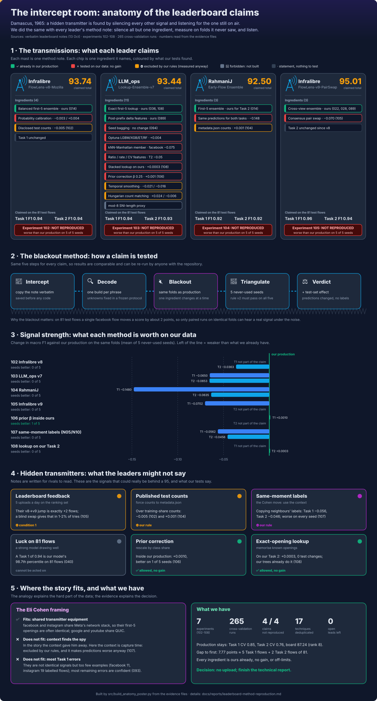

# The intercept room

In the usual telling of the Eli Cohen story, Syrian counter-intelligence found his hidden transmitter in Damascus by silencing
every other signal and listening for the one still on air. We treated the leaderboard the same way: each leader's method note
is a transmission, and we silence everything except one ingredient to hear whether it carries a real signal on our data.



## How to read it

| Part | Story | What it shows |
|---|---|---|
| 1. The transmissions | Four masts on air | The four method notes (experiments 102-105): claimed total and per-task F1, and every ingredient as a chip coloured by our finding: in our production, no gain, excluded by our rules, or forbidden |
| 2. The blackout method | Silence the city, then listen | The five steps every claim went through: verbatim note, frozen protocol, paired runs on identical folds, five never-used seeds, verdict and test-set effect |
| 3. Signal strength | The direction finder's needle | Each method's change in macro F1 against our production (mean of five seeds). Everything sits at or left of the line, so nothing beats what we already have |
| 4. Hidden transmitters | What a spy would not broadcast | The levers the leaders may not disclose, with our tests: leaderboard feedback, published counts, same-moment labels (107), luck, prior correction (106), exact lookup (108) |
| 5. Where the story fits | The verdict on the analogy | The analogy fits the Meta siblings (shared "transmitter equipment"); its decisive clue, context, is off-limits here and does not help anyway. Right panel: what we have and the decision |

## Three takeaways

1. **Every ingredient is accounted for.** Of 17 techniques in the notes, 5 are already in our production, 8 gave no gain on our
   data, and 4 are excluded by our rules (3 were measured anyway; the SNI proxy is never built).
2. **The context clue fails here.** Copying the labels of flows opened at the same moment, the move that caught the spy, makes
   predictions worse on every seed: apps open connections to several services at once (107).
3. **The gap is small in flows, not in methods.** 7.77 points is about 5 Task 1 flows and 2 Task 2 flows out of 81; no
   described method closes it, so we keep production and finish the technical report.

The poster is generated, so its numbers follow the evidence:

```bash
.venv/bin/python src/build_anatomy_poster.py
```

Details and every score: [Leaderboard method reproduction](../reports/leaderboard-method-reproduction.md) and
[Leaders against ours](../reports/leaders-vs-ours-dedup.md).
