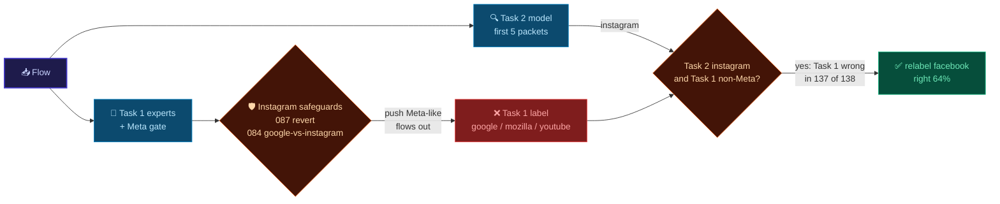
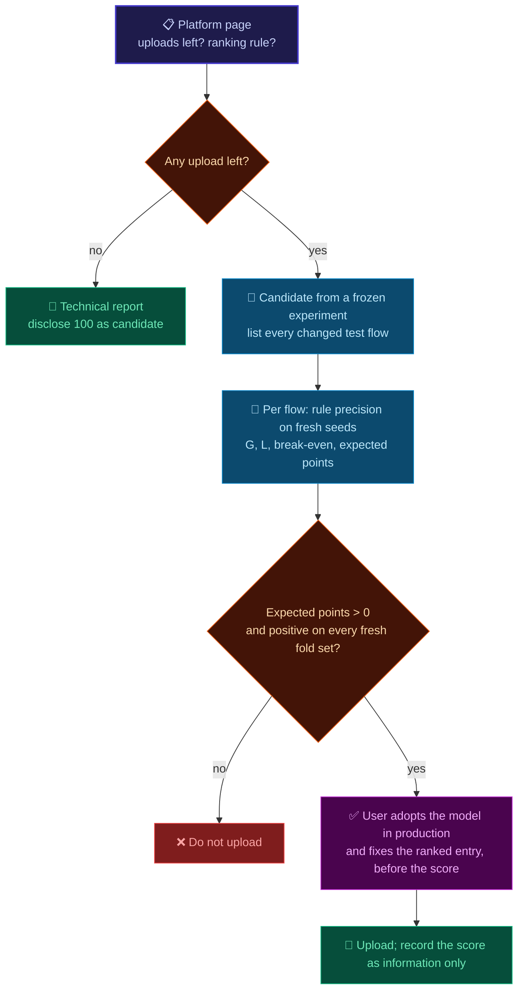

# Closing the F1 gap: the next insight

Written 12 October 2026, after experiments [099](../../experiments/099_class_count_deficit.md) and
[100](../../experiments/100_cross_task_meta_rescue.md). Every number comes from cross-validation on the 330 labelled flows or from our
own predicted test labels. No test label and no `label_counts` from `metadata.json` were used.

> **Update, 12 October 2026:** the user adopted experiment 100 FB in production as a deliberate exception
> (`models.task1_cross_task`, CV macro F1 0.857). Its file is
> [`submissions/production-100-cross-task/`](../../submissions/production-100-cross-task/README.md): one change from the ranked
> entry (`flow_000223` youtube → facebook), validated. Uploaded the same day (upload 8): 86.36, Task 1 0.822 (−0.87 points vs
> 87.24), inside the downside range in section 4. The score is information only; production and the ranked entry stay as decided
> before it.

## Bottom line

1. **The gap is Task 1.** The leader is at 93.19 and our ranked entry at 87.24, a gap of 5.95 points. Task 1 accounts for about 5.2 of
   them and Task 2 for about 0.7.
2. **The most likely large Task 1 loss on the test set is instagram.** We predict 2 instagram test flows; the stratified split
   implies about 5. A shortfall that large happened in 0 of 50 CV folds. If both calls are right and 3 flows are missed, instagram
   F1 is 0.57, which costs about 3.6 points.
3. **Our scores cannot find the missing flows.** Among flows not called instagram, the one with the highest instagram score is truly
   instagram only 14-16% of the time. Filling the count blindly loses: Δ −0.017 macro F1, with 27% of flips right.
4. **New insight: when Task 2 says instagram and Task 1 says a non-Meta app, Task 1 is wrong.** It was wrong in 137 of 138 such cases
   (8 seeds, ordinary folds). The cause is inside our own Task 1 pipeline: two instagram safeguards push these flows to google or mozilla.
   Relabelling them **facebook**, not instagram, gains +0.011 macro F1 on 5 fresh seeds (positive on all 5, rule v2 BETTER on 1).
   On twin-aware folds it gains +0.030 (BETTER on 5 of 5).
5. **On the test set it changes one flow**, flow_000223 (youtube → facebook). That is worth +1.9 points if right and −0.5 to −1.1 if
   wrong, about +0.7 to +1.0 points in expectation. It cannot close a 6-point gap.
6. **Bold submissions need an upload first.** Our ledger says upload 7 was the last one, so check the platform page before anything
   else. If uploads remain, the protocol in section 6 is how to be bold without probing the leaderboard. A one-flow file can only be
   uploaded after the model behind it has been adopted in production (the 084 precedent). Otherwise it is a label probe, which 080
   ruled out.

## 1. Where the points are

| Task | Leader (30 Sept screenshot) | Ours (ranked entry, upload 7) | Gap (points) |
|---|---:|---:|---:|
| Task 1 macro F1 | 0.94 (rounded) | 0.840 | about 5.2 |
| Task 2 macro F1 | 0.92 (rounded) | 0.905 | about 0.7 |
| Total | 93.19 | 87.24 | **5.95** |

To find which Task 1 class loses on the test set without labels, we compare the counts we predict with the counts the stratified
60/20/20 split implies (099, analysis A and B).

| Class | Expected on test (validation × 81/83) | Task 1 predicted | Deviation | CV range per 81 flows (5th-95th) |
|---|---:|---:|---:|---|
| facebook | 2.9 | 3 | +0.1 | −2.5 to +2.5 |
| google | 32.2 | 33 | +0.8 | −2.5 to +4.9 |
| **instagram** | **4.9** | **2** | **−2.9** | −2.5 to +1.9 (≤ −3 in 0 of 50 folds) |
| mozilla | 9.8 | 9 | −0.8 | −2.5 to +1.9 |
| x | 17.6 | 20 | +2.4 | −1.9 to +2.5 |
| youtube | 13.7 | 14 | +0.3 | −3.7 to +2.5 |

If the test set holds 5 instagram flows and both instagram calls are right:

$$
F_1^{\text{instagram}} = \frac{2\,TP}{P + T} = \frac{2 \cdot 2}{2 + 5} = 0.57
\quad\Rightarrow\quad
\text{cost} = \frac{1 - 0.57}{6} \times 50 \approx 3.6 \text{ points}
$$

In CV, the instagram flows Task 1 misses go to facebook (50%), youtube (24%), google (19%), and rarely to x or mozilla. So the
missing test instagram flows are most likely among our facebook, youtube and google calls, not among the extra x calls.

## 2. What will not close it

| Lever | Best evidence | Verdict |
|---|---|---|
| More modelling on the same columns | 086, 088, 092, 094 and 096 tie or lose; the learning curve is still rising (093) | Exhausted |
| Decision rules on close calls | Oracle bound +1.14 points, realistic +0.1 to +0.3 ([093 §7](../../data_limited_analysis/REPORT.md)) | Too small |
| Filling the instagram count by score | 099: 27% of flips right, Δ −0.017 | Loses |
| Leader-style count matching | 095: worse than production in all arms | Loses |
| Uploading variants and keeping the best | Out of scope (leaderboard probing) | Not allowed |

The only lever with size is more labelled flows from the challenge's own capture setup, about +1 point per ~43 flows (093). The team
ruled that out for this deadline.

## 3. The insight: the two task models disagree about Meta

Task 2's model sees only the first five packets. For facebook and instagram, those opening packets are very similar. Task 1 sees
the whole flow, and its pipeline has two safeguards that stop non-Meta flows from being called instagram. When the opening is
clearly Meta but the rest of the flow looks like google, those safeguards push a real Meta flow out of Meta.

In the stage trace (seed 2026, 12 cases), 6 cases were inside Meta after the gate and the 087 revert pushed them out (5 facebook,
1 instagram). The 084 verifier turned 2 instagram flows into google. The remaining 4 never entered Meta.

| | Post hoc (099; seeds 2026-2028) | Fresh, ordinary folds (100; 2046-2050) | Fresh, twin-aware folds (100; 5 sets) |
|---|---|---|---|
| Cases | 52 | 86 | 221 |
| Truly Meta | 50 (96%) | 86 (100%) | 204 (92%) |
| Truly facebook / instagram | 32 / 18 | 55 / 31 | 143 / 61 |
| Relabel facebook: Δ macro F1 | +0.008 to +0.015 | +0.006 to +0.021 (mean **+0.011**) | +0.029 to +0.032 (pooled **+0.030**) |
| Folds won / lost | 28 / 11 | 44 / 22 | 87 / 27 |
| Rule v2 BETTER | 3 of 3 | **1 of 5** | 5 of 5 |
| Relabel instagram: Δ macro F1 | +0.000 to +0.003 | −0.001 to +0.002 (25 W / 41 L) | not run |

The following caveats limit this result:

- **Few flows carry it.** The 86 fresh cases come from 10 distinct flows (5 facebook, 5 instagram), and one of them, flow_001145, is
  35% of the cases.
- **The label is right 64% of the time, not 100%.** The other 36% are instagram flows that become facebook: still wrong, and they
  lower facebook precision.
- **The test looks like ordinary folds.** The twin-aware gain is larger because Task 1 cannot memorise the facebook twins
  flow_000809 and flow_001168 there. The test resembles ordinary folds (036), so +0.011 is the relevant number.
- **It is narrow on purpose.** Using Task 2's label in every close call lost −0.013 (038). The signal exists only for Task 2 =
  instagram with Task 1 outside Meta.
- **By the frozen rule, it is not adopted.** It is positive on all 10 fresh fold sets, but BETTER on only 1 of 5 ordinary seeds.
  The rule fires about once every 3 folds, so most folds tie and rule v2 has little power. Experiment 028 was adopted as a
  deliberate exception on a weaker profile.

## 4. What it means for the test file

Exactly one test flow qualifies: **flow_000223**. Task 1 calls it youtube (the experts' mean is youtube 0.49, instagram 0.43,
facebook 0.04); Task 2 calls it instagram. The table gives the points (50 × macro F1) for relabelling it. They are computed from
our predicted test counts, the expected counts, and 089's precision on the fresh seeds
([test_ev.json](../../experiments/100_evidence/test_ev.json)).

| Relabel to | If it is facebook | If it is instagram | If youtube was right | Pays off when P(right) exceeds |
|---|---:|---:|---:|---:|
| facebook | **+1.89** | −0.51 | −1.14 | 0.38 |
| instagram | −0.25 | **+1.87** | −0.87 | 0.32 |

| Probabilities used (all cases Meta) | facebook / instagram | Expected points, relabel facebook | Expected points, relabel instagram |
|---|---|---:|---:|
| All fresh cases | 64 / 36 | **+1.03** | +0.52 |
| Folds where instagram is under-predicted (the test's situation) | 55 / 45 | **+0.80** | +0.71 |
| Distinct flows | 50 / 50 | +0.69 | +0.81 |

- **Facebook is the label to use.** CV supports it (the instagram arm is about zero), and it has the higher expected value in two
  of the three readings. The test's instagram shortfall narrows the gap between the two labels but does not reverse it.
- **The other two count-rule candidates stay as they are.** flow_001187: Task 1 says facebook and Task 2 says instagram. In that
  configuration Task 1 is right 73% of the time, and flipping a facebook call to instagram pays only above 51%. flow_001003 (google,
  instagram score 0.18) has no supporting signal.
- **Ceiling:** one flow, +1.9 points at best. 87.24 + 1.9 = 89.1, still below 93.19.

## 5. Why only one flow can move

Section 3's rule passes the break-even test from section 4, while the score-based rescue of 099 does not. For a flip from class A
to class B, with $G$ the points gained if B is right and $L$ the points lost if A was right:

$$
p^{*} = \frac{L}{G + L}
$$

Small classes pay about 2 points per correct flow, so $p^{*}$ is low: about 0.32-0.38 for flips into facebook or instagram from
youtube. Our instagram score among non-instagram calls is right 14-27% of the time, below the break-even, which is why 099's rescue
loses. The cross-task rule's facebook label is right 64% of the time, above it. On the test set it fires once.

## 6. A safe way to make bold submissions

**Bold** means changes with positive expected points under CV-calibrated probabilities, even when rule v2 cannot confirm them
because the event is rare. Uploading many small variants and keeping the best one is **not** bold: it is leaderboard probing. A file
that differs from an earlier upload in one flow reveals that flow's label. Our precedents draw the line:

| Precedent | File | Decision |
|---|---|---|
| [084](../../experiments/084_pair_verifiers.md) (upload 6) | 1 test change; the model passed rule v2 and was adopted in production before the upload | Uploaded; the score is information only |
| [080](../../experiments/080_chance_to_beat_production.md) | 1 test change from 062 N2, a candidate that was not adopted | Not uploaded: it would act as a label probe (condition 1; `.mission.md` out of scope) |

So a few-flow file is uploaded only when its model is production, adopted on CV evidence through the normal path or a deliberate
exception, before the upload.

1. **Check the platform page:** uploads left, and whether the final ranking uses the latest, the best or a chosen submission. By our
   count 7 are used and none are left.
2. **Build the candidate from a frozen experiment** and list every test flow it changes.
3. **For each changed flow,** write down the rule that changed it, the rule's precision on fresh seeds, $G$, $L$ and the break-even.
   Sum to the file's expected points and its worst case.
4. **Upload only if** the expected points are positive, the rule is positive on every fresh fold set (exception path, user
   decision) or passes rule v2 (normal path), **and** the model has been adopted in production before the upload.
5. **Decide before the upload** whether the file becomes the ranked entry, by CV evidence only, and record it in
   `submissions/uploads.csv`.
6. **After the score:** record it as information. Never infer which changed flow was right, and never use the score to choose the
   next file.

## 7. Recommendation

| Priority | Action | Owner | Effect |
|---|---|---|---|
| **P0** | Check uploads left and the ranking rule on the platform page | Charles | Decides whether anything below can reach the leaderboard |
| ✅ Done | Adopt 100 FB in production as a deliberate exception (user decision 2026-10-12) and build the file: `submissions/production-100-cross-task/` | Sid | One test change; expected +0.7 to +1.0 points, best +1.9, worst −1.1 |
| P1 | If an upload remains: upload `submissions/production-100-cross-task/submission.zip`; it becomes the ranked entry whatever it scores | Sid | The score is information only |
| P1 | If none remain: report 100 in the technical report as the production Task 1 model's last component (a deliberate exception), with its mechanism and the Task 2 → Task 1 disclosure | Sid | Honest report; no score change |
| P0 | Spend the remaining days on the technical report | Sid, Charles | Required by the submission guidelines |

The honest reading: the next real insight is that Task 1's own instagram safeguards misfire on Meta flows with Meta-like openings.
Fixing that is worth about one point on CV and one flow on the test set. The rest of the gap to 93.19 needs information our 330
labelled flows do not contain.

## 8. After upload 8: what the loss teaches, and the plan to 23 October

Upload 8 (the 100 file) scored 86.36: Task 1 0.822, −0.87 points against upload 7. One flow changed, and the change lost. That is
inside the downside written down before the upload, so the arithmetic was right. The decision to upload was the mistake.

### Lessons

| # | Lesson | Evidence |
|---|---|---|
| 1 | **A one-flow change is a coin flip, not a test of a method.** Its expected gain (+0.7) was smaller than its spread (+1.9 to −1.1), and its score says nothing about whether the +0.011 CV gain is real | Section 4; upload 8 |
| 2 | **"Adopt first, then upload" did not stop the label reveal.** It made the one-flow file formally compliant (084 precedent), but the score still disclosed one test label, which is what 080 refused | 080, 084, upload 8 |
| 3 | **A CV gain and an upload slot are different decisions.** 100 is a fair model improvement (Δ > 0 on 10 of 10 fresh fold sets). It touches one test flow, so on the leaderboard it is worth about +0.5 points in expectation, far below the 81-flow noise | 040, section 4 |
| 4 | **Comparing 100 with 028 and 034 was misleading.** Those exceptions changed many predictions; 100 changes one. The size of the bet, not only its sign, decides whether an upload is worth it | Section 3 |

Upload rule (user decision 2026-10-12, now in AGENTS.md Working rules): **upload only a file from a model that
passed rule v2 on never-used seeds, and that differs from every earlier upload in at least 3 test predictions.** Exception-path
models can still be adopted for the final model and the report; they are not uploaded on their own.

### Can any tactic reach 95?

A total of 95 needs a macro F1 sum of 1.90; upload 8 has 1.727, a gap of 8.6 points. With Task 2 unchanged, Task 1 would need
0.995 (perfect). Even at Task 2's identical-opening ceiling (0.93), Task 1 would need 0.97.

| Tactic family | Best evidence | Can it supply 8.6 points? |
|---|---|---|
| Decision rules (thresholds, counts, cross-task rescues) | Real rules recover about +0.15 CV points; the close-call oracle is +1.14 (093 §7) | ❌ |
| Fix every error whose true app is our second choice | Top-two oracle: +10.5 CV points, but no real rule gets near it: most of those errors are confident (093 §7) | ❌ (oracle only) |
| New learners, ensembles, features | Every experiment since 064 within about ±0.02 macro F1 | ❌ |
| Own captures | Session labels do not match the destination-based challenge labels; capture setup differs (056-063) | ❌ |
| Destination labels for own captures (SNI of our own traffic) | Blocked by the conservative reading of condition 3; transfer unproven | ⚠️ user's rules decision; not recommended with 11 days left |
| Outside data, pretrained models, capture time or order | Out of scope (team rules); small in CV anyway (002, 039, 078, 091) | ❌ |
| Upload many variants and keep the best, or re-upload the 88.11 file to restore the score | Choosing by test score (condition 1; `.mission.md`) | ❌ |

**95 is not reachable with the information we may use.** Getting there would mean correcting errors whose true app is not even
in our models' top two, which takes information the 330 labelled flows do not contain. The leader's 93.19 sits at about the
99th percentile of our own resampling distribution (040).

### Plan to 23 October

| Priority | Action | Why |
|---|---|---|
| P0 | Keep production (100) and the ranked entry as fixed before the score | Anything else is choosing by test score |
| P0 | No further uploads unless a file meets the upload rule (none does now) | Lessons 1-3 |
| P0 | Charles checks the platform page: upload allowance and whether the ranking uses the latest, the best or a chosen upload | If it uses the best upload, 88.11 already stands |
| P0 | Write the technical report: models, the documented exceptions (028, 034, 100), the Task 2 → Task 1 inputs, compliance | Required; organisers inspect code and reports and may remove violating submissions |
