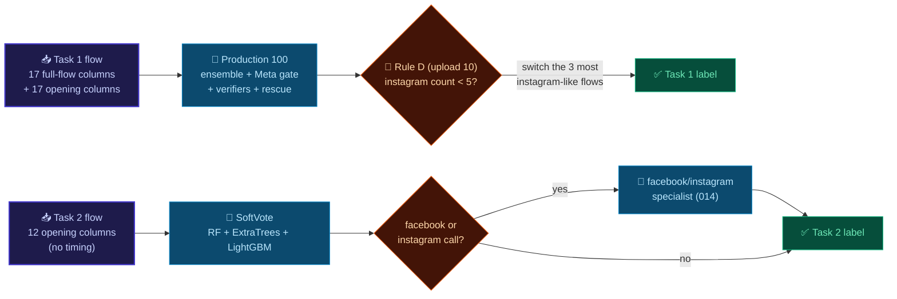

# How we got 90.85

**In one paragraph.** Our entry (team Telex) is the production pipeline (Task 1 = experiment 100, Task 2 = experiment 014) with one
rule applied to Task 1: the model called only 2 of the 81 test flows instagram, while the labelled data's mix says about 5 should
be (19 of 330), so the 3 test flows the model rated most instagram-like were switched to instagram. Task 1 rose from 0.822 to
0.912 macro F1 and the total from 86.36 to **90.85**, fifth on the board. The rule uses no test labels, no test class counts and no
leaderboard score; it is reproducible from a script. In cross-validation the same rule is slightly *worse* on average, so the
upload was a deliberate bet that paid off on this test set, and the technical report must say so.

## 1. The result

Leaderboard row, Final Test Phase, read 21 October ([raw](../../submissions/raw/leaderboard-final-test-2026-10-21.txt)):

| Team | Task 1 macro F1 | Task 1 accuracy | Task 1 points | Task 2 macro F1 | Task 2 accuracy | Task 2 points | Total |
|---|---:|---:|---:|---:|---:|---:|---:|
| Telex | 0.912 | 0.90 | 45.60 | 0.905 | 0.89 | 45.25 | **90.85** |

Standings in Charles's later 21 October snapshot: Infralibre 95.01, HeriTech 94.98, LLM_ops 93.44, RahmaniJ 92.50, **Telex 90.85
(5th)**, Flow State 88.99, 图个乐呵队 88.17, Artur Baranovsky 87.36, OpenOrbit Labs (Charles) 86.96.

## 2. The pipeline behind the file

The diagram shows how one test flow becomes a prediction in each task.



| Task | Model | Built in | Cross-validation macro F1 |
|---|---|---|---:|
| Task 1 | Soft-voting ensemble (random forest, extra trees, LightGBM) with the Task 2 opening columns (022), two clerks (028), Meta gate (034), pair verifiers (084), rest-of-flow expert and rules (089), cross-task Meta rescue (100) | 30 Sep to 12 Oct | 0.857 |
| Task 1 rule of upload 10 | 099 rule D: raise the instagram count to the labelled mix | 21 Oct (127) | 0.838 |
| Task 2 | Balanced SoftVote on 12 opening columns without timing (007), facebook/instagram calls re-decided by an unweighted specialist (014) | 30 Sep | 0.754 |

Task 2 reads only Task 2 files (condition 2). Task 1 also reads the Task 2 opening columns, which the rules allow (disclosed since
022).

## 3. Every upload and what it changed

| Upload | Date | What changed | Task 1 | Task 2 | Total |
|---:|---|---|---:|---:|---:|
| 1 | 30 Sep | SoftVote ensemble; Task 2 specialist | 0.766 | 0.905 | 83.56 |
| 2 | 30 Sep | Task 1 reads the opening columns (022) | 0.787 | 0.905 | 84.62 |
| 3 | 9 Oct | Two clerks + Meta gate (028, 034) | 0.850 | 0.905 | 87.77 |
| 4 | 9 Oct | Rest-of-flow expert (066, never adopted) | | | about 86 |
| 5 | 9 Oct | Instagram verifier (083; same predictions as 3) | 0.850 | 0.905 | 87.77 |
| 6 | 9 Oct | Pair verifiers (084) | 0.857 | 0.905 | 88.11 |
| 7 | 10 Oct | Bundle (089) | 0.840 | 0.905 | 87.24 |
| 8 | 12 Oct | Cross-task rescue (100): 1 flow changed | 0.822 | 0.905 | 86.36 |
| 9 | 16 Oct | Re-upload of 6 | 0.857 | 0.905 | 88.11 |
| **10** | **21 Oct** | **Production + rule D: 3 flows switched to instagram (127)** | **0.912** | 0.905 | **90.85** |
| 11 | 21 Oct | 10 + 109 B in Task 2: 1 flow changed (128) | | | about 87 |

The big honest gains came from model work (uploads 2, 3, 6: +4.5 points). After 88.11, cross-validation gains stopped carrying
over: the test set holds only about 3 facebook and 5 instagram flows, so a single flow moves the score by about a point either way
(uploads 8 and 11 lost, 10 won).

## 4. Upload 10: what and why

**What.** Rule D of experiment 099, written on 12 October and applied unchanged by `src/exp127_count_guided_candidate.py`:

1. Expected instagram flows in Task 1's 81 test flows: round(81 × 19/330) = **5**.
2. Production predicts **2**.
3. Switch the **3** test flows production does not call instagram with the highest instagram score (the mean of the three experts'
   instagram probabilities) to instagram.

| Flow | Production | Upload 10 | Instagram score |
|---|---|---|---:|
| `flow_000223` | facebook | instagram | 0.427 |
| `flow_001187` | facebook | instagram | 0.292 |
| `flow_001003` | google | instagram | 0.184 |

**Why it was tried.** Experiment 099 had found that Task 1's instagram shortfall on the test set (2 predicted where about 5 are
expected) was larger than in any of 50 cross-validation folds. Macro F1 weights every app equally, so with about 5 instagram test
flows, correcting a few of them moves Task 1 by several points.

## 5. The evidence, kept honest

| Evidence | Says |
|---|---|
| Cross-validation of rule D (099, on the 089 model) | flips right 27% of the time; Δ −0.0169 macro F1 (7 wins, 20 losses, 23 ties) |
| Cross-validation of rule D on production 100 (notebook 07) | Task 1 0.857 → 0.838; facebook F1 0.72 → 0.66, instagram 0.79 → 0.76 |
| Test set (upload 10 vs upload 8, same base file) | Task 1 0.822 → **0.912** |

**Reading.** The rule loses on average but won on this test set, which was unusual in exactly the way the rule corrects. That makes
90.85 a real, rule-compliant score and a lucky one: it is information about this test set, not evidence that the rule works in
general. We did not use the score to work out which of the three flows were right, and we built no follow-up files by varying them.

## 6. Compliance

| Condition | Status |
|---|---|
| 1. No test labels for training or selection | ✅ The count comes from the 330 labelled train + validation flows; test `label_counts` in `metadata.json` were never read; no leaderboard score chose the flows |
| 2. Task 1 features not used for Task 2 | ✅ Task 2 unchanged and reads only Task 2 files |
| 3. No identifier recovery | ✅ None |
| 4. Outside information disclosed | ✅ None used in this file (our own captures were tested and never used in a submission) |
| 5. Code, report and predictions inspectable | ✅ The file rebuilds exactly from the script and the production model; hashes in the [candidate README](../../submissions/candidate-127-meta-count-guided/README.md); Charles verified the rebuild independently on 21 October |
| Our own upload rule (rule v2 on fresh seeds, at least 3 changes) | ❌ Not met: rule D failed cross-validation. Uploaded as a deliberate bet by Sid; disclosed |

## 7. Draft disclosure for the technical report

> The submitted Task 1 predictions are those of our production model with one post-processing rule. The model predicted 2
> instagram flows among the 81 test flows, while the class proportions of the labelled training and validation data imply about 5.
> We relabelled the three test flows with the highest predicted instagram probability among those not predicted instagram. The rule
> uses only labelled training proportions and the model's own scores; no test labels or test class counts were used. In repeated
> cross-validation the rule reduced Task 1 macro F1 slightly (0.857 to 0.838), so it was submitted as a deliberate decision rather
> than on validation evidence; on the test set it raised Task 1 macro F1 from 0.822 to 0.912. Task 2 predictions are unchanged.

## 8. Reproduce

```sh
.venv/bin/python src/make_final_candidate.py --out submissions/production-100-cross-task   # production file (100 + 014), byte-identical rebuild
.venv/bin/python src/exp127_count_guided_candidate.py                                      # upload 10: rule D on that file
```

The second command writes `submissions/candidate-127-meta-count-guided/submission.json`
(SHA-256 `1ee9da4ee670d779e9902d464e65a8e90854a45e70749351f305fdeb1c308442`).
