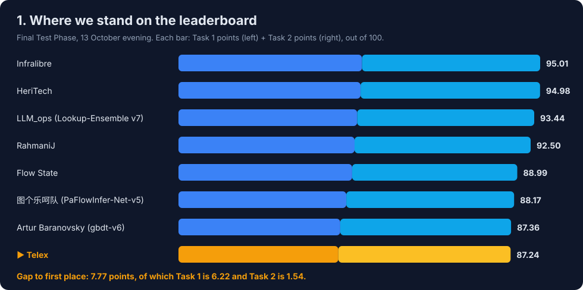
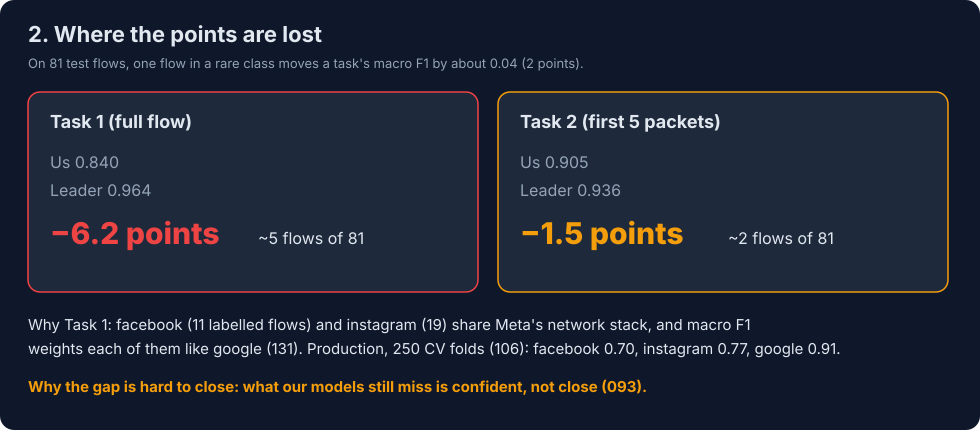
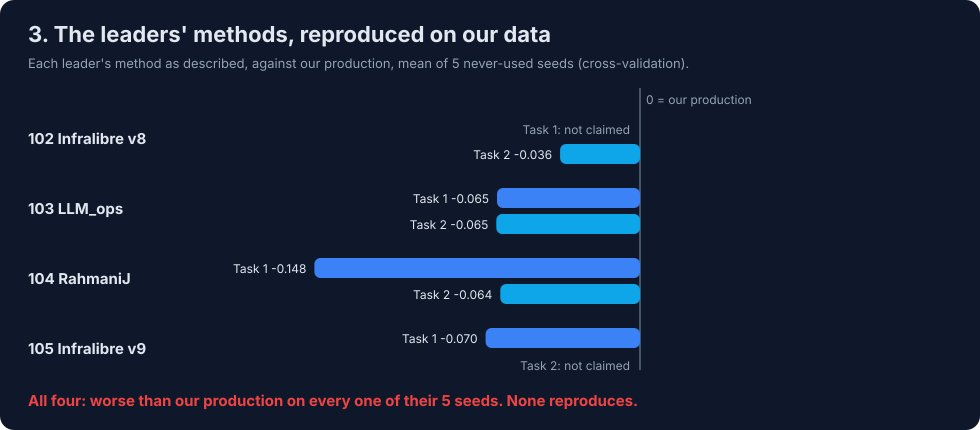
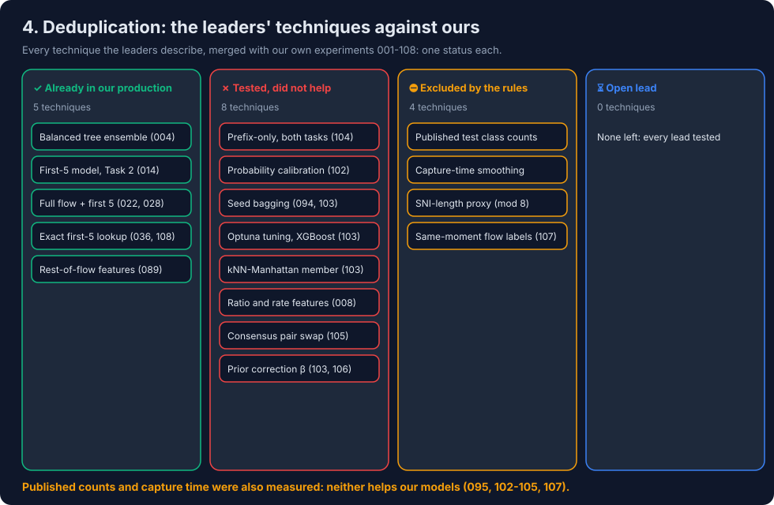
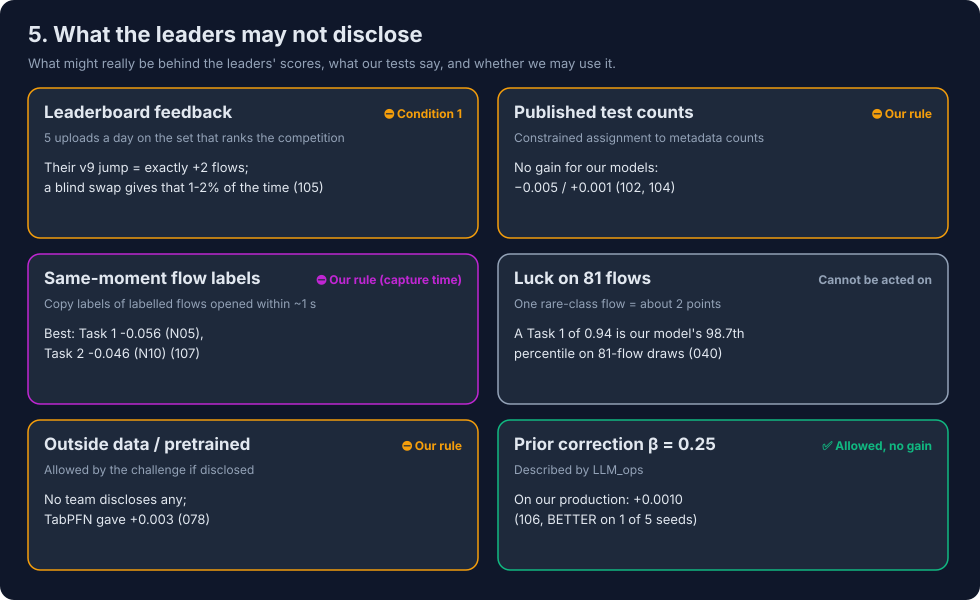
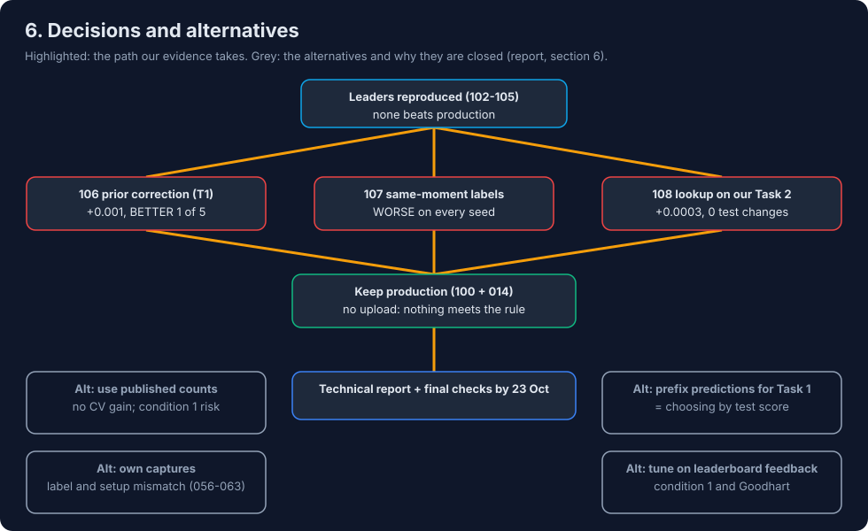

# Leaders against ours: deduplication and decision

**In one line:** every technique the leaders describe is already in our production, measured as worse, or excluded by the
rules. The levers they might not disclose (106-108) add nothing either. We keep production and finish the technical report.

The figures are built from the evidence files by `src/build_dedup_figures.py` (section 8), so they update when the evidence
does.

## 1. Why this stage

After reproducing four leaders (102-105) and finding that none beats our production, two questions were left:

1. **Have we really tried everything they describe?** Their notes list more than a dozen techniques. Some we adopted weeks ago,
   some we rejected, some we had only tested on a leader's base, never on ours. Deduplicating means one row per technique, one
   status each, so nothing falls through the gaps (section 4).
2. **What might they not be saying?** Sid, 2026-10-13: the leaders "may not disclose what exactly happened, so we need to find
   out what it could be and then again ... reproduce some experiments which have good chances to close up the gaps." Section 5
   lists the candidates and tests each one that can be tested honestly.

## 2. Where we stand

The leaderboard on 13 October (evening), split into Task 1 and Task 2 points:



The gap to first place is 7.77 points: **6.22 in Task 1** and 1.54 in Task 2. On 81 test flows, one flow in a rare class moves a
task's macro F1 by about 0.04, so the gap is roughly 5 flows in Task 1 and 2 in Task 2:



The Task 1 gap sits on facebook and instagram. They share Meta's network stack, have the fewest labelled flows (11 and 19), and
count as much in macro F1 as google (131). Over 250 cross-validation folds (106), production scores facebook 0.70, instagram
0.77 and google 0.91. What production still gets wrong is mostly **confidently** wrong: of 162 Task 1 errors in 093, only 19
are close calls ([data-limited analysis](../../data_limited_analysis/REPORT.md), section 7). A cleverer decision rule cannot
reach the rest.

## 3. The four reproductions, in one picture

Details are in the [method reproduction report](leaderboard-method-reproduction.md). Each leader's method as described, against
our production on identical folds (mean of five never-used seeds):



All four are worse than production on every one of their five seeds. The reason is the same each time: their base model
starts 0.02-0.15 below ours, and the extra steps they describe do not make up the difference.

## 4. Deduplication: one row per technique

Every technique in the four notes, merged with our own experiments:



| Technique | Described by | Our experiments | Status | Effect on our models |
|---|---|---|---|---|
| Class-balanced tree ensemble | Infralibre, LLM_ops, RahmaniJ | [004](../../experiments/004_ceilings_ensemble_thresholds.md), [014](../../experiments/014_fb_ig_specialist.md) | ✅ in production | Base of every model (+0.038 Task 1 in 004) |
| First-5 model for Task 2 | Infralibre, RahmaniJ | [014](../../experiments/014_fb_ig_specialist.md), [102](../../experiments/102_flowlens_reproduction.md) | ✅ in production | Task 2 production; their version −0.019 to −0.036 |
| Full flow + first 5 together ("cross-view") | Infralibre v9, LLM_ops | [022](../../experiments/022_t1_plus_prefix.md), [028](../../experiments/028_two_clerks.md), [105](../../experiments/105_pairswap_reproduction.md) | ✅ in production | +0.036 (022); their ensemble −0.065 (105) |
| Rest-of-flow ("post-prefix delta") features | LLM_ops | [030](../../experiments/030_rest_of_flow.md), [065](../../experiments/065_task1_rest_expert.md), [089](../../experiments/089_near_miss_bundle.md) | ✅ in production | As a third expert: part of 089's +0.014 |
| Exact first-5 lookup | LLM_ops | [036](../../experiments/036_twin_aware.md), [103](../../experiments/103_lookup_ensemble_reproduction.md), [108](../../experiments/108_task2_exact_opening_override.md) | ✅ in production (Task 1 override; Task 2 trees) | On our Task 2: +0.0003, 0 test changes (108) |
| One prediction set for both tasks | RahmaniJ | [104](../../experiments/104_early_flow_reproduction.md) | ❌ worse | Task 1 −0.148 |
| Probability calibration | Infralibre v8 | [102](../../experiments/102_flowlens_reproduction.md) | ❌ no gain | −0.003 (sigmoid), +0.004 (isotonic) on their base |
| Seed bagging | LLM_ops | [094](../../experiments/094_variance_reduction.md), [103](../../experiments/103_lookup_ensemble_reproduction.md) | ❌ no gain | 44-46 of 50 folds identical (094) |
| Optuna tuning, XGBoost | LLM_ops | [103](../../experiments/103_lookup_ensemble_reproduction.md) | ❌ no gain | +0.004 with bagging, on their base |
| kNN-Manhattan member | LLM_ops | [016](../../experiments/016_smooth_models.md), [103](../../experiments/103_lookup_ensemble_reproduction.md) | ❌ no gain | Task 2 +0.006 (near-miss); Task 1 facebook −0.075 (016) |
| Ratio, rate and CV features | LLM_ops | [008](../../experiments/008_feature_families.md), [103](../../experiments/103_lookup_ensemble_reproduction.md) | ❌ no gain | Task 1 none; Task 2 −0.05 to −0.06 (008) |
| Prior correction β = 0.25 | LLM_ops | [103](../../experiments/103_lookup_ensemble_reproduction.md), [106](../../experiments/106_prior_correction_production.md) | ❌ no gain | On production: +0.001, BETTER on 1 of 5 seeds |
| Count-preserving consensus pair swap | Infralibre v9 | [105](../../experiments/105_pairswap_reproduction.md) | ❌ worse | −0.020 on production; breaks 2-3 correct flows per fixed one |
| Same-moment flow labels (not claimed; inferred) | none explicitly | [107](../../experiments/107_temporal_label_neighbours.md) | ⛔ rule, measured: worse | −0.056 to −0.092 (Task 1), −0.046 to −0.060 (Task 2) |
| Published test class counts | Infralibre v8, LLM_ops, RahmaniJ | [095](../../experiments/095_disclosed_count_simulation.md), [099](../../experiments/099_class_count_deficit.md), [102](../../experiments/102_flowlens_reproduction.md), [104](../../experiments/104_early_flow_reproduction.md) | ⛔ rule, measured: no gain | −0.005 / +0.001 over training-share counts |
| Capture-time smoothing | LLM_ops | [039](../../experiments/039_capture_order.md), [103](../../experiments/103_lookup_ensemble_reproduction.md) | ⛔ rule, measured: worse | −0.021 (Task 1), −0.016 (Task 2) |
| SNI-length proxy (mod-8 bytes) | LLM_ops | not built | ⛔ condition 3 | — |

**Reading:** 5 techniques are already ours, 8 were tested and do not help, 4 are excluded and were measured anyway (3 of them do
not help, the fourth is not built). No open lead is left. The one row that was still open when this stage started, the
exact lookup on our Task 2, became experiment 108: production already does it.

## 5. What the leaders may not disclose

A leaderboard note is written by a team that knows its rivals read it. So beyond what the notes say, we listed what could
really be behind a 95, tested what can be tested, and checked whether we may use it:



| Candidate | How it would work | What our tests say | May we use it? |
|---|---|---|---|
| **Leaderboard feedback** | 5 uploads a day on the set that ranks the competition; keep the flips that score | Infralibre's v8 → v9 jump is exactly +2 Task 1 flows; a label-blind swap gives that in 1-2% of batches (105) | ⛔ No: condition 1, and Goodhart |
| **Published test counts** | Force predicted class counts to the counts in `metadata.json` | Over training-share counts: −0.005 (102), +0.001 (104) | ⛔ No: derived from test labels (our rule) |
| **Same-moment flow labels** | A flow takes the label of labelled flows opened within about a second | Worse on every seed in both tasks; 3 correct flows broken per fixed one (107) | ⛔ No: capture time is excluded |
| **Luck on 81 flows** | A strong model having a good draw | A Task 1 of 0.94 is our model's 98.7th percentile on 81-flow draws (040) | Cannot be acted on |
| **Outside data or pretrained models** | Allowed by the challenge if disclosed | No team discloses any; TabPFN as an extra expert gave +0.003 (078) | ⛔ No: our rule (own captures excepted, Task 1 only) |
| **Prior correction** | Rescale probabilities by class share | +0.001 on production, BETTER on 1 of 5 seeds (106) | ✅ Yes, but no gain |

Three experiments tested the leads with any chance of a gain, each with a protocol frozen before any code and never-used seeds:

| Experiment | Question | Result | Test predictions changed |
|---|---|---|---:|
| [106](../../experiments/106_prior_correction_production.md) | Prior correction β = 0.25 inside Task 1 production | +0.0010; BETTER on 1 of 5 seeds; not adopted | 1 |
| [107](../../experiments/107_temporal_label_neighbours.md) | Labels of training flows opened within 0.5-2 s (measurement only) | WORSE on every seed in both tasks; the nearest flow in time alone scores −0.35 / −0.26 | not built |
| [108](../../experiments/108_task2_exact_opening_override.md) | Exact-opening lookup on Task 2 production | +0.0003; INCONCLUSIVE on 5 of 5 seeds; production already predicts every single-label opening | 0 |

**Why 107 fails** (the most promising-looking lead): labels follow the destination server, not the app on screen (041). While
one app is in use the phone opens connections to several services at once, so flows opened together often carry different
labels. **Why 108 fails:** our trees already memorise exact openings; Task 2's remaining errors sit on openings seen with more
than one label (093), which no lookup can resolve.

**What is left** is luck on 81 flows and leaderboard feedback. Neither is a method we can reproduce, and the second would break
condition 1. This is a reading of the evidence, not an accusation: their notes may be honest, and a strong model can draw well.

## 6. Alternatives, and why each is closed

The path our evidence takes (highlighted) and the alternatives (grey):



| Alternative | What it would do | Evidence | Why not |
|---|---|---|---|
| Use the published test counts | Match predicted counts to `metadata.json` | No CV gain (095, 102, 104) | Derived from test labels (condition 1, our rule) |
| Use the first-5 predictions for Task 1 | Our Task 2 file scored 0.905 on test, above our Task 1 (0.82-0.84) | Task 1 −0.148 in CV (104) | Choosing a model by its test score, against CV: Goodhart |
| Train Task 1 on our own captures (e.g. Charles's Chrome round) | More facebook and instagram flows | −0.084 / −0.072 (056), Android −0.059 (063) | Label and setup mismatch; allowed for Task 1 only, so possible with a new protocol, but the chance is small |
| Tune on leaderboard feedback | Keep the uploads that score | Their +2 flows look like this (105) | Condition 1; overfits 81 flows |
| **Keep production, finish the technical report** | Spend the last ten days on the report and final checks | Production is ahead of every reproduction on every seed | **Recommended** |

## 7. Decision

- **Production stays as it is:** Task 1 `models.task1_cross_task` (100), Task 2 `models.task2_model` (014).
- **No upload:** nothing from 102-108 passes rule v2 on all five seeds, and none changes 3 or more test predictions (the
  upload rule in AGENTS.md).
- **Next:** the technical report (P0, draft by 20 October), including this deduplication as evidence that the gap to the
  leaders was investigated honestly. A Chrome capture pilot remains possible for Task 1 if Charles wants it, under its own
  protocol.
- **What would change this:** a leader note that describes a mechanism our data can test and that we have not tested, or a
  capture round that passes `src/capture_checks.py` gates 1 and 2 and then rule v2.

## 8. Reproducibility

| Item | Value |
|---|---|
| Figures | `docs/reports/figures/dedup-*.svg`, built by `src/build_dedup_figures.py` from `experiments/10[2-8]_evidence/analysis.json` and the saved leaderboard text |
| New experiments | 106 (10 runs, seeds 2121-2125), 107 (50 runs, 2126-2130), 108 (15 runs, 2131-2135); every run in `results/` and checked by `src/runs.py verify` |
| Protocols | Frozen and committed before any code: `4057c43` (106), `0c66c16` (107), `bc20954` (108) |
| Runners | `src/exp106_prior_correction_production.py`, `src/exp107_temporal_label_neighbours.py`, `src/exp108_task2_exact_opening_override.py`; each has `--smoke`, `--all`, `--analyse` (106 and 108 also `--test-effect`) |
| Boundaries | Train + validation labels only; test features only for test-effect counts; Task 2 reads only its own files; capture time only in the 107 measurement |

```bash
.venv/bin/python src/exp108_task2_exact_opening_override.py --smoke
.venv/bin/python src/exp108_task2_exact_opening_override.py --all
.venv/bin/python src/exp108_task2_exact_opening_override.py --analyse
.venv/bin/python src/build_dedup_figures.py
```
