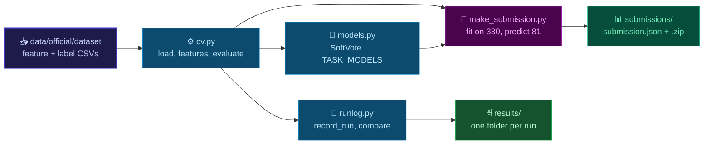

# Code walkthrough notebooks

The project's four core files as notebooks: the code in order, with notes between the cells and small demos. Read them
in number order.

| Notebook | Source file | What it covers |
|---|---|---|
| [01-cv-data-features-evaluation.ipynb](01-cv-data-features-evaluation.ipynb) | `src/cv.py` | Loading a task, the feature sets per task, 50-fold cross-validation, rest-of-flow features |
| [02-models.ipynb](02-models.ipynb) | `src/models.py` | `SoftVote`, every model tried, the Task 2 model (014), the layers of the Task 1 model (100), and confusion matrices of both production models |
| [03-make-submission.ipynb](03-make-submission.ipynb) | `src/make_submission.py` | The entry point: train on train + validation, predict test, check, write the file |
| [04-runlog.ipynb](04-runlog.ipynb) | `src/runlog.py` | How each CV run is recorded, compared with the champion (rule v2) and checked |
| [05-facebook-instagram.ipynb](05-facebook-instagram.ipynb) | deep dive (uses `cv`, `models`) | Facebook vs instagram only: a two-app model, the columns that separate them, and every production stage traced flow by flow (reproduces the champion runs exactly) |
| [06-leaderboard-comparison.ipynb](06-leaderboard-comparison.ipynb) | comparison (leaderboard + champion runs) | Error budget per team from the 16 October leaderboard (our row updated to upload 10, 90.85), our cross-validation confusion matrices scaled to 81 flows, the points one error of each type costs, and where the submitted file is expected to lose points (cost × expected errors per cell); no test labels or test-matrix reconstruction |
| [07-confusion-over-time.ipynb](07-confusion-over-time.ipynb) | history (saved runs, same folds) | Per-app F1 and the key confusion cells at every production milestone (30 Sep to 12 Oct) plus upload 10's count rule (21 Oct, worse in CV, best on the test set), and the change from the first to the current model |

This is how the files depend on each other:

## Running them

Open them with the project environment (`.venv`, Python 3.13.1). Each notebook finds the project root by itself, so it
runs from any folder inside the repository. The saved outputs come from a run on 2026-10-15. Notebooks 1 to 4 take
about 40 seconds together on an M4 Pro; notebook 5 takes about 9 minutes (it refits models on 50 folds several times);
notebooks 6 and 7 a few seconds.

- ✅ They do not change project files. Notebook 3 writes its submission to a temporary folder and checks that it matches
  `submissions/production-100-cross-task/` (0 differences in both tasks). Notebook 4 only reads existing runs and never
  calls `record_run`.
- ✅ They follow the challenge rules: Task 2 code reads only Task 2 files, and no test labels are used.

## Keeping them in step with the code

⚠️ The code cells are copies of the source files at commit `3b4c9c2`. **The `.py` files in `src/` are the ones the
project runs.** If a source file changes, these copies go out of date. Only `__file__` paths and the submission output
folder were changed in the copies, and each change is commented.
